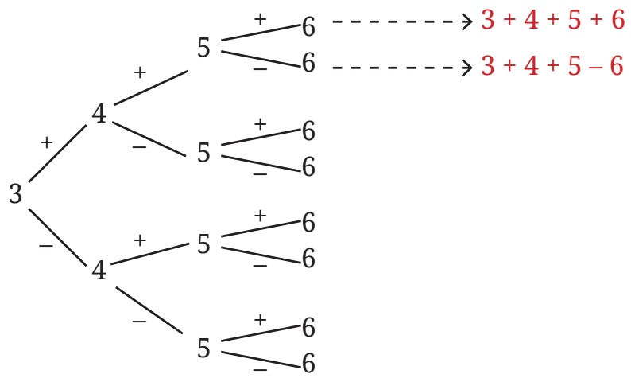
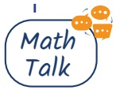

Eight such expressions are possible. You can use the diagram below to systematically list all the possibilities.

Evaluate each expression and write the result next to it. Do you notice anything interesting?

? Now, take four other consecutive numbers. Place the ‘+’ and ‘–’ signs as you have done before. Find out the results of each expression. What do you observe?

? Repeat this for one more set of 4 consecutive numbers. Share your findings.

Math Talk

$$
3+4-5+6=8
$$

$$
5+6-7+8=12
$$

$$
3 - 4 - 5 - 6 = -12
$$

$$
5-6-7-8=16
$$

Some sums appear always no matter which 4 consecutive numbers are chosen. Isn’t that interesting?

？ Do these patterns occur no matter which 4 consecutive numbers are chosen? Is there a way to find out through reasoning?

**Hint:** Use algebra and describe the 8 expressions in a general form.

You might have noticed that the results of all expressions are even numbers. Even numbers have a factor of 2. Negative numbers having a factor 2 are also even numbers, for example, $- 2 , - 4 , - 6 ,$ and so on. Check if anyone in your class got an odd number.

When 4 consecutive numbers are chosen, no matter how the ‘+’ and ‘–’ signs are placed between them, the resulting expressions always have even parity.