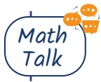

Now take any 4 numbers, place ‘+’ and ‘–’ signs in the eight different ways, and evaluate the resulting expression. What do you observe about their parities?

Repeat this with other sets of 4 numbers.

Is there a way to explain why this happens?

**Hint:** Think of the rules for parity of the sum or difference of two numbers.

**Explanation 1:** Let us consider any of the 8 expressions formed by four numbers $a , b , c ,$ and d. When one of its signs is switched, its value always increases or decreases by an even number! Let us see why.

Consider one of the expressions: $a + b - c - d .$

Replacing +b by – b, we get

$$
a - b - c - d .
$$

By how much has the number changed? It has changed by

$$
( a + b - c - d ) - ( a - b - c - d )
$$

$a+b-c-d-a+b+c+$ d (notice how the signs changed when we opened the second set of brackets)

= 2b (this is an even number).

If the difference between two numbers is even, can they have different parities? No! So either both are even or both are odd.

Now, let us see what happens when a negative sign is switched to a positive sign.

? Replace any negative sign in the expression a + b – c – d with a positive sign and find the difference between the two numbers.

## What do you conclude from this observation?

Starting from any expression, we can get 7 expressions by switching one or more ‘+’ and ‘–’ signs. Thus, all the expressions have the same parity!

**Explanation 2:** We know that

$$
\mathrm{odd} \pm \mathrm{odd} = \mathrm{even}
$$

$$
\mathrm { e v e n } \pm \mathrm { e v e n } = \mathrm { e v e n }
$$

$$
\mathrm{odd} \pm \mathrm{even} = \mathrm{odd}.
$$

We have seen that the parity of $a + b$ and a – b is the same, regardless of the parities of a and b.

In short, $a \pm b$ have the same parity. By the same argument, $a \pm b \pm c$ and $a \pm b - c$ have the same parity. Extending this further, we can say that all the expressions $a \pm b \pm c \pm$ d have the same parity.