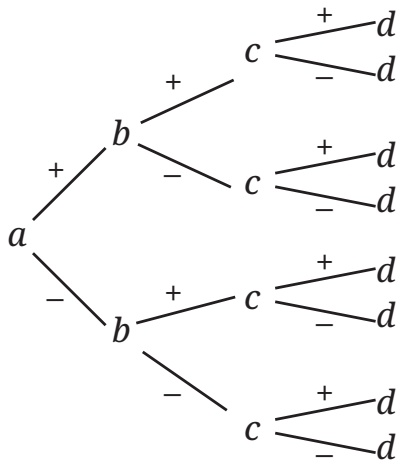

**Explanation 3:** This can also be explained using the positive and negative token model you studied in the chapter on Integers. Try to think how.

The number of ways to choose 4 numbers a, b, c, d and combine them using ‘+’ and ‘–’ signs is infinite. Mathematical reasoning allows us to prove that all the combinations $a \pm b \pm c \pm d$ always have the same parity, without having to go through them one by one.

Several problems in mathematics can be thought about and solved in different ways. While the method you came up with may be dear to you, it can be amusing and enriching to know how others thought about it. Two tidbits: ‘share’ and ‘listen’.

？ Is the phenomenon of all the expressions having the same parity limited to taking 4 numbers? What do you think?

‘What if …?’, ‘Will it always happen?’— Wondering and posing questions and conjectures is as much a part of mathematics as problem solving.

## Breaking Even

We know how to identify even numbers. Without computing them, find out which of the following arithmetic expressions are even.

$$
4 3 \pm 3 7
$$

$$
6 7 2 - 3 4 8
$$

$$
4 \times 3 4 7 \times 3
$$

708 – 477

809 + 214

$$
1 1 9 \times 3 0 3
$$

543 – 479

5133

？ Using our understanding of how parity behaves under different operations, identify which of the following algebraic expressions give an even number for any integer values for the letter-numbers.

$$
2 a \pm 2 b
$$

$$
3 g \pm 5 h
$$

$$
4 m \pm 2 n
$$

$$
2 u - 4 v
$$

13k – 5k

$$
6 m - 3 n
$$

$$
x ^ { 2 } + 2
$$

$$
b ^ { 2 } + 1
$$

$$
4 k \times 3 j
$$