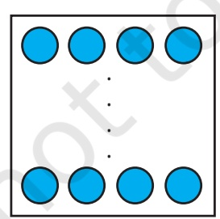
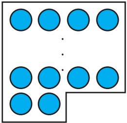

The expression 4m + 2q will always evaluate to an even number for any integer values of m and q. We can justify this in two different ways —

We know 4m is even and 2q is even for any integers m and q. Therefore, their sum will also be even.

The expression $4 m \pm 2 q$ is equal to the expression $2 ( 2 m + q )$ . Here, the expression $2 ( 2 m + q )$ means 2 times $2 m + q .$ In other words, 2 is a factor of this expression. Therefore, this expression will always give an even number for any integers m and q.

For example, if m = 4 and $q = - 9 ,$ , the expression 4m + 2q becomes $4 \times 4 + 2 \times ( - 9) = - 2$ , which is an even number.

In the expression x2 + 2, x2 is even if x is even, and $x ^ { 2 }$ is odd if x is odd. Therefore, the expression $x ^ { 2 }   +   2$ will **not** always give an even number. An example and a non-example for when the expression evaluates to an even number — (i) if x = 6, then $x ^ { 2 } + 2 = 3 8$ , and (ii) if x = 3, then $x^{2} + 2 = 11.$

？ Similarly, determine and explain which of the other expressions always give even numbers. Write a couple of examples and non-examples, as appropriate, for each expression.

？ Write a few algebraic expressions which always give an even number.

## Pairs to Make Fours

## ？ Take a pair of even numbers. Add them. Is the sum divisible by 4?

Try this with different pairs of even numbers.

When is the sum a multiple of 4, and when is it not?

Is there a general rule or a pattern?

Even numbers can be of two types based on the remainders they leave when divided by 4.

Even numbers that are multiples of 4 leave a remainder of 0 when divided by 4.

Even numbers that are not multiples of 4 leave a remainder 2 when divided by 4.