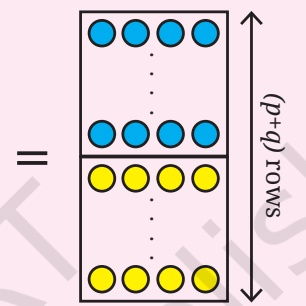
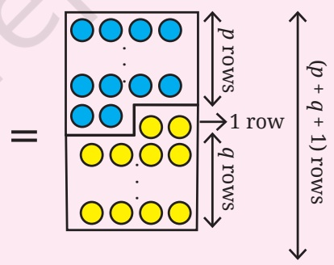

? When will two even numbers add up to give a multiple of 4?

This problem is similar to the question of identifying when adding two numbers will result in an even number. Can you see this?

There are three cases to examine:

<table><tr><td colspan="4">Explanation with Algebra and Visualisation</td><td>Examples 4, 12, 16, 24,</td></tr><tr><td>Adding two (even) numbers that are multiples of 4 will always give a multiple of 4.</td><td>4p and 4q.  $4 p + 4 q$   $= 4 \: ( p + q ) .$ </td><td> </td><td></td><td>36.  $\begin{array}{l}12 + 16 \\= 4\left(3 + 4\right) \\= 28.\end{array}$   $\begin{array}{l}\frac{46 + 28}{= 4\ (4 + 7)} \\= 44.\end{array}$ </td></tr><tr><td>Adding two even numbers that are not multiples of 4 will always give a multiple of 4 because their remainders of 2 add up to 4.</td><td> $( 4 p + 2 ) \; \mathrm { a n d } \; ( 4 q + 2 ) .$   $\begin{array} { r l } & { ( 4 p + 2 ) + ( 4 q + 2 ) } \\ & { = 4 p + 4 q + 4 } \\ & { = 4   ( p + q + 1 ) . } \end{array}$ </td><td></td><td></td><td>2, 6, 10, 18, 22,42.  $2 + 6 = 8.$   $\begin{array} { l } 6 + 1 0 = 1 6 . \\ 2 2 + 6 = 2 8 . \end{array}$ </td></tr></table>

What happens when we add a multiple of 4 to an even number that is not a multiple of 4? Is it similar to the case of the parity of the sum of an even and an odd number?

? Look at the following expressions and the visualisation. Write the corresponding explanation and examples.