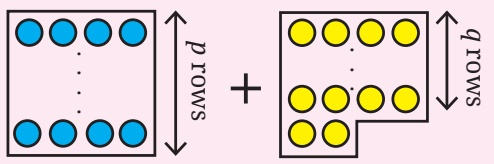

$$
\begin{array} { r l } & { | \begin{array} { l } { 4 p \mathrm { ~ a n d ~ } ( 4 q + 2 ) } \\ { = 4 p + ( 4 q + 2 ) } \\ { = 4 p + 4 q + 2 } \\ { = 4 ( p + q ) + 2 . } \end{array} | \underbrace { \overbrace { \bigcirc \bigcirc \bigcirc \bigcirc \bigcirc } ^ { \bigcirc } } _ { \bigcirc \bigcirc \bigcirc \bigcirc } | \begin{array} { l } { \overbrace { \bigcirc \bigcirc \bigcirc } ^ { \bigcirc } } \\ { \overbrace { \bigcirc \bigcirc } ^ { \bigcirc } } \\ { \overbrace { \bigcirc \bigcirc } ^ { \bigcirc } } \\ { \bigcirc \bigcirc } \end{array} + | \begin{array} { l } { \bigcirc \bigcirc \bigcirc \bigcirc } \\ { \bigcirc \bigcirc \bigcirc } \\ { \bigcirc \bigcirc } \\ { \bigcirc } \end{array} | \begin{array} { l } { \overbrace { \bigcirc \bigcirc } ^ { \bigcirc } } \\ { \bigcirc \bigcirc } \\ { \bigcirc } \\ { \bigcirc } \\ { \bigcirc } \end{array} + | \begin{array} { l } { \bigcirc \bigcirc \bigcirc \bigcirc \bigcirc } \\ { \bigcirc \bigcirc } \\ { \bigcirc \bigcirc } \\ { \bigcirc } \\ { \bigcirc } \end{array} | \begin{array} { l } { \bigcirc } \\ { \bigcirc } \\ { \bigcirc } \\ { \bigcirc } \\ { \bigcirc } \\ { \bigcirc } \end{array} | } \\ & { = \underbrace { | \begin{array} { l } { \bigcirc \bigcirc \bigcirc \bigcirc } ^ { \bigcirc } } \\ { \bigcirc \bigcirc \bigcirc } \\ { \bigcirc \bigcirc } \\ { \bigcirc \bigcirc } \\ { \bigcirc } \\ { \bigcirc } \end{array} | } \\ & { = \underbrace { | \begin{array} { l } { \bigcirc \bigcirc \bigcirc } ^ { \bigcirc } } \\ { \bigcirc \bigcirc \bigcirc } \\ { \bigcirc \bigcirc } \\ { \bigcirc } \\ { \bigcirc } \\ { \bigcirc } \end{array} | } \end{array} | \begin{array} { l } { \bigcirc } \\ { \bigcirc } \\ { \bigcirc } \\ { \bigcirc } \\ { \bigcirc } \\ { \bigcirc } \\ { \bigcirc } \\ { \bigcirc } \\ { \bigcirc } \\ { \bigcirc } \\ { \bigcirc } \\ { \bigcirc } \\ { \bigcirc } \\ { \bigcirc } \end{array} | \begin{array} { l } { \bigcirc } \\ { \bigcirc } \\ { \bigcirc } \\ { \bigcirc } \\ { \bigcirc } \\ { \bigcirc } \\ { \bigcirc } \\ { \bigcirc } \\ { \bigcirc } \\ { \bigcirc } \\ { \bigcirc } \\ { \bigcirc } \\ { \bigcirc } \\ { \bigcirc } \\ { \bigcirc } \\ { \bigcirc } \\ { \bigcirc } \\ { \bigcirc } \\ { \bigcirc } \end{array} | \begin{array} { l } { \bigcirc } \\ { \bigcirc } \\ { \bigcirc } \\ { \bigcirc } \\ { \bigcirc } \\ { \bigcirc } \\ { \bigcirc } \\ { \bigcirc } \\ { \bigcirc } \\ { \bigcirc } \\ { \bigcirc } \\ { \bigcirc } \\ { \bigcirc } \\ { \bigcirc } \\ { \bigcirc } \\ { \bigcirc } \\ { \bigcirc } \end{array}
$$

Notice how we are able to generalise and prove properties of arithmetic using algebra and also using visualisation.

## Always, Sometimes, or Never

？ We examine different statements about factors and multiples and determine whether a statement is ‘Always True’, ‘Sometimes True’, or ‘Never True’.

We know that the sum of any two multiples of 2 is also a multiple of 2.

？ 1. If 8 exactly divides two numbers separately, it must exactly divide their sum.

<table><tr><td colspan="4">Explanation with Algebra and Visualisation</td><td>Examples</td></tr><tr><td>The two numbers have 8 as a factor; in other words, the two numbers are multiples of 8.</td><td>8a and 8b.</td><td colspan="2"></td><td>8 and 16. 16 and 56. 80 and 120.</td></tr><tr><td>As multiples of 8 are obtained by repeatedly adding 8, the sum of two multiples of 8 will also be a multiple of 8.</td><td> $8 a \pm 8 b$   $= 8 \: ( a + b ) .$ </td><td>00000000 00000000 00000000</td><td>7 a rows (a+b) rows b rows</td><td> $\begin{array} { l } { { 8 \pm 1 6 = 8 ( 1 \pm 2 ) } } \\ { { = 2 4 . } } \end{array}$   $16+56=72.$   $80+120=200.$ </td></tr></table>

Statement 1 is always true. Determine if it is true with subtraction.