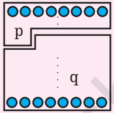
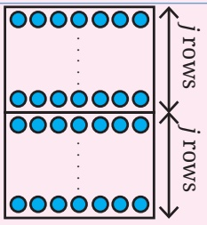
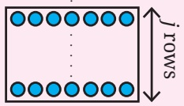

In general, **if a divides M and a divides N, then a divides M + N and a divides M – N. In other words, if M and N are multiples of a, then M + N and M – N will also be multiples of a.**

？ 2. If a number is divisible by 8, then 8 also divides any two numbers (separately) that add up to the number.

<table><tr><td colspan=3>Explanation with Algebra and Visualisation</td><td>Examples</td></tr><tr><td>A numberdivisible by 8 isa multiple of 8.</td><td>8m</td><td rowspan=2>nrows  u(a+b) rows,            b rowsoooo</td><td rowspan=2>8, 16, 56, 72.72 = 48 + 24(8×98×6+8×3).72 = 50 + 22</td></tr><tr><td>A numberdivisibleby 8 can beexpressed asa sum of twomultiples of 8 orsum of two non-multiples of 8.</td><td> $8m = 8a + 8b$ 8m = p + q(p, q notmultiples of8)</td></tr></table>

So, statement 2 is sometimes true.

3. If a number is divisible by 7, then all multiples of that number will be divisible by 7.

<table><tr><td colspan="4">Explanation with Algebra and Visualisation Examples</td></tr><tr><td>Numbers divisible by 7 will have 7 as a factor.</td><td colspan="2">7j</td><td> $14 = 7 \times 2 (j = 2).$   $42 = 7 \times 6 (j = 6).$   $98 = 7 \times 14 (j = 14).$ </td></tr><tr><td>This contains a total of mj rows. So this is also a multiple of 7.</td><td>(7j)×m</td><td> m times </td><td>Some multiples of 14:  $2 8 = ( 7 \times 2 ) \times 2 .$   $7 0 = ( 7 \times 2 ) \times 5 .$   $1 5 4 = ( 7 \times 2 ) \times 1 1$ </td></tr></table>

The number 7jm or $( 7   \times   j   \times   m )$ has a factor of 7. We can see that Statement 3 is always true.