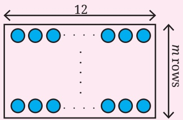
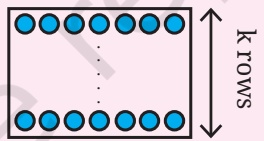
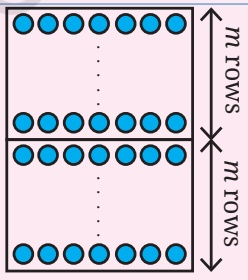
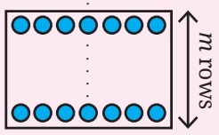

In general, **if A is divisible by k, then all multiples of A are divisible by k.**

？ 4. If a number is divisible by 12, then the number is also divisible by all the factors of 12.

<table><tr><td colspan=3>Explanation with Algebra and Visualisation</td><td>Examples</td></tr><tr><td>A number divisible by12 is a multiple of 12.</td><td>12m</td><td></td><td>12, 24, 36, 48,108, 132.</td></tr><tr><td>Factors of multiples of12 will include factorsof 12.</td><td>12m $= 2 \times 6 \times m$  $= 3 \times 4 \times m$ </td><td>A factor of 12 covers a row fully.Hence, it covers all multiples of 12fully.</td><td>Factors of 24: 1,2, 3, 4, 6, 8, 12,24.</td></tr></table>

In general, **if A is divisible by k, then A is divisible by all the factors of k.** Hence, Statement 4 is always true.

？ 5. If a number is divisible by 7, then it is also divisible by any multiple of 7.

<table><tr><td colspan=4>Explanation with Algebra and Visualisation</td><td>Examples</td></tr><tr><td>Numbers divisible by7 are multiples of 7.</td><td>7k</td><td></td><td></td><td></td></tr><tr><td>Multiples of 7.7k will be divisible by7m if and only if m is afactor of k.</td><td colspan=3>个7m $Ifk = ym$                  then $7k \div 7m =$                                  k rows $\mathit { 7 y m } \div 7 m$ </td><td>42 $( 7 \times 6 )$ is divisibleby 7 but it is notdivisible by $2 8 \: ( 7 \times 4 )$ 42 $( 7 \times 6 )$ is divisibleby 7 and it is divisibleby $1 4 \left( 7 \times 2 \right)$ </td></tr></table>

We can see that this statement is only sometimes true.