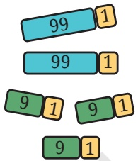
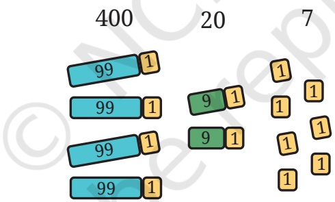
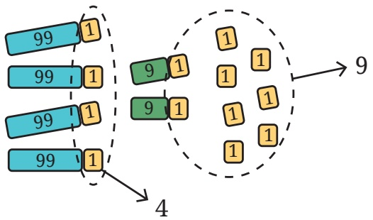

？ Can we say that any number made up of only the digits ‘0’ and ‘9’, in any order, will always be divisible by 9?

Yes, if each digit is either 0 or 9, then each term in its expanded form will be $9 \times  口   or  \tilde{0} \times  口 ( the   口$ denotes a place value). This means each term will be a multiple of 9, for example,

$$
99009=9\times10000+9\times1000+0\times100+0\times10+9\times1.
$$

But this shortcut alone cannot identify all the multiples of 9. Unlike the numbers 2, 5, and 10, we cannot identify the multiples of 9 by just looking at the unit’s digit. 99 and 109 are two numbers with 9 as the units digit; but 99 is divisible by 9, while 109 is not.

Is 10 divisible by 9? If not, what is the remainder?

Check the divisibility of other multiples of 10 (10, 20, 30, ...) by 9.

You will notice that for any multiple of 10, the remainder is the same as the number of tens.

? Similarly, look at the remainder when the multiples of 100 (100, 200, 300, … ) are divided by 9. What do you notice?

The remainder is the same as the number of hundreds for any multiple of 100.

？ Using this observation, find the remainder when 427 is divided by 9.

We see that 427 has 4 hundreds; thus, its corresponding remainder (upon division by 9) would be 4. 427 has 2 tens, and its corresponding remainder would be 2. We have 7 units also remaining. Adding all the remainders, we get 4 + 2 + 7 = 13. We can make one more group of 9 with 13, leaving a remainder of 4. Therefore, 427 ÷ 9 gives a remainder of 4.

(Remainder)