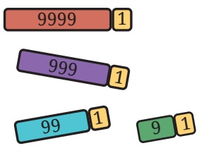
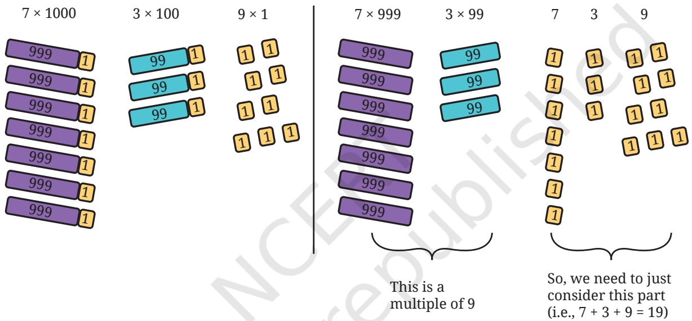

Will this work with bigger numbers?

You can see that this is true for any place value:

$$
1 = 0 + 1
$$

$$
1 0 = 9 + 1
$$

$$
100 = 99 + 1
$$

$$
1000=999+1
$$

10000 = 9999 + 1, and so on. Each digit thus denotes the remainder when the corresponding place value is divided by 9.

For example, to find the remainder of 7309 when divided by 9, we can just add all the digits $7+3+0+9-10$ get 19. This can be seen as follows:

7 × 1000

3 × 100

9 × 1

7 × 999

3 × 99

$$
7 \times 1000 + 3 \times 100 + 0 \times 10 + 9 \times 1
$$

$$
7 \times (999 + 1) + 3 \times (99 + 1) + 0 \times (9 + 1) + 9 \times (0 + 1)
$$

$$
( 7 \times 999 + 3 \times 99 + 0 \times 9 + 9 \times 0 ) \div ( 7 \times 1 + 3 \times 1 + 0 \times 1 + 9 \times 1 )
$$

$$
\begin{aligned}= \underbrace{(7 \times 999 + 3 \times 99 + 0 \times 9 + 9 \times 0) + (7 + 3 + 0 + 9)}_{}.\end{aligned}
$$

This is a multiple of 9

So, we need to just consider this part

This means that the number 7309 is 19 more than some multiple of 9. The digits 1 and 9 can further be added to get 1 + 9 = 10. Now, we can say that 7309 is 10 more than a multiple of 9. And repeating this step for the number 10, we get the remainder to be 1 + 0 = 1, meaning 7309 is 1 more than a multiple of 9. Therefore, 7309 ÷ 9 gives a remainder of 1.

A number is divisible by 9 if and only if the sum of its digits is divisible by 9. Also, we can add the digits of a number repeatedly till a single digit is obtained. This single digit is the remainder when the number is divided by 9.

？ Look at each of the following statements. Which are correct and why?

(i) If a number is divisible by 9, then the sum of its digits is divisible by 9.