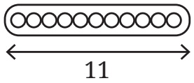
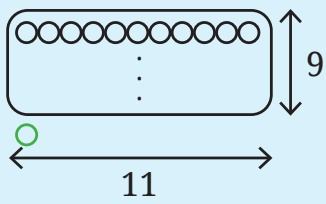
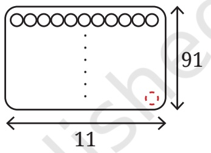

<table><tr><td>Units place(1)</td><td>11×0 = 01 = 11 × 0 + 1</td><td>1 is one morethan a multipleof 11.</td><td></td></tr><tr><td>Tens place(10)</td><td>11× 1 = 1110 = 11×1-1</td><td>10 is one lessthan a multipleof 11.</td><td rowspan=4></td></tr><tr><td>Hundredsplace (100)</td><td>11×9 = 99100 = 11×9 + 1</td><td>100 is one morethan a multipleof 11.</td></tr><tr><td>Thousandsplace(1000)</td><td>11 × 91 = 10011000 = 11×91-1</td><td>1000 is one lessthan a multipleof 11.</td></tr><tr><td></td><td></td><td></td></tr></table>

This alternating pattern of one more than 11 and one less than 11 continues for higher place values.

Since 400 contains 4 hundreds, 400 is 4 more than a multiple of 11 (396 + 4). Since 60 contains 6 tens, 60 is 6 less than a multiple of 11 (66 – 6). Since 2 contains 2 units, 2 is 2 more than a multiple of 11, i.e., 2 = (0 + 2).

？ Using these observations, can you tell whether the number 462 is divisible by 11?

What could be a general method or shortcut to check divisibility by 11?

