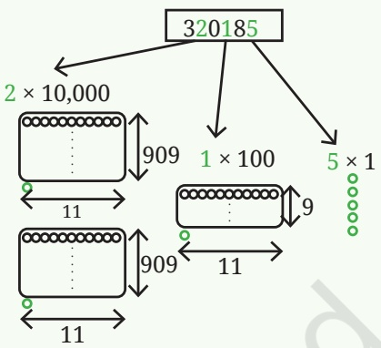
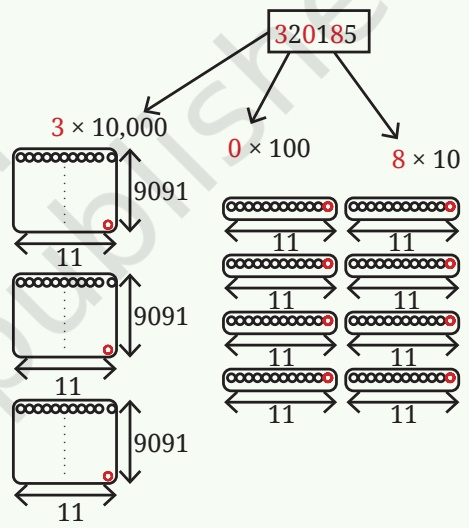

We saw that the place values alternate as 1 more and 1 less than a multiple of 11. Using this observation,

<table><tr><td>Steps</td><td>Purpose</td><td>Example for the Number 320185</td></tr><tr><td>1. Add the digits of place values which are 1 more (than a multiple of 11), i.e., place values corresponding to 1, 100, 10000, and so on.</td><td>To know how much in excess we are with respect to a multiple of 11 for these place values.</td><td></td></tr><tr><td>2. Add the digits of place values which are 1 less (than a multiple of 11), i.e., place values corresponding to 10, 1000, 100000, and so on.</td><td>To know how short we are with respect to a multiple of 11 for these place values.</td><td>Total excess, 2 + 1 + 5 = 8. </td></tr><tr><td>3. Compute the difference between these two sums, i.e., (number in excess) – (number short).</td><td>To know the remainder obtained when divided by 11.</td><td>Total short, 3 + 0 + 8 = 11. 00000000000 8-11 = - 3. (3 short of a multiple of 11)</td></tr></table>

The difference between these two sums 8 – 11 = – 3, indicating that the number 3,28,105 is 3 short of or 8 more than a multiple of 11.

？ If this difference is 11 or a multiple of 11, what does that say about the remainder obtained when the number is divisible by 11?

？ Using this shortcut, find out whether the following numbers are divisible by 11. Further, find the remainder if the number is not divisible by 11. (i) 158   (ii) 841   (iii) 481   (iv) 5529   (v) 90904   (vi) 857076