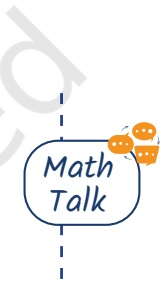

Aryabhata II’s (c. 950 CE) work Mahāsiddhānta, mentions the method of computing the digital root of a number by repeatedly adding the digits till a single-digit number is obtained. This method is known to have been used to perform checks on calculations of arithmetic operations.

## Figure it Out

1. The digital root of an 8-digit number is 5. What will be the digital root of 10 more than that number?

2. Write any number. Generate a sequence of numbers by repeatedly adding 11. What would be the digital roots of this sequence of numbers? Share your observations.

3. What will be the digital root of the number $9a + 36b + 13?$

4. Make conjectures by examining if there are any patterns or relations between

(i) the parity of a number and its digital root.

(ii) the digital root of a number and the remainder obtained when the number is divided by 3 or 9.

## 5.3 Digits in Disguise

Last year, we saw cryptarithms—puzzles where each letter stands for a digit, each digit is represented by at most one letter, and the first digit of a number is never 0.

## ？ Solve the cryptarithms given below.

| $\frac { \mathrm { ~ \scriptsize ~ \mathrm { ~ A 1 ~ } ~ } } { \mathrm { ~ \scriptsize ~ \mathrm { ~ A B ~ } ~ } }$ (i) (ii) | $\frac{\frac{ AB }{1 + 37}}{6A}$ (iii) | $\frac { \begin{array} { c } { \mathrm { O N } } \\ { \mathrm { O N } } \\ { \mathrm { O N } } \end{array} } { \begin{array} { c } { \mathrm { P O } } \end{array} }$ QR QR (iv) $\frac { \mathrm { ~ ~ { ~ + ~ } { Q \mathrm { R } } ~ } } { \mathrm { P R R } }$ |
| --- | --- | --- |

Let us now try solving some cryptarithms involving multiplication.

(v) $PQ \times 8 = RS,$

Guna says, “Oh, this means a 2-digit number multiplied by 8 should give another 2-digit number. I know that $10 \times 8 = 80$ . But the units digits of 10 and 80 are the same, which we don’t want. For the same reason PQ cannot be 11 as P and Q correspond to different digits. $1 2 \times 8 = 9 6$ fits all the conditions”. Can PQ be 13? Think.

It is not possible because $1 3 \times 8 = 1 0 4 .$ . For all 2-digit numbers greater than 12, the product with 8 is a 3-digit number.