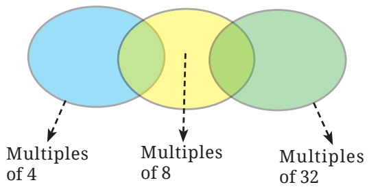
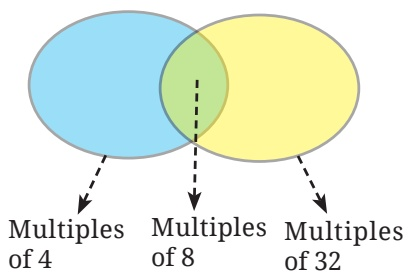
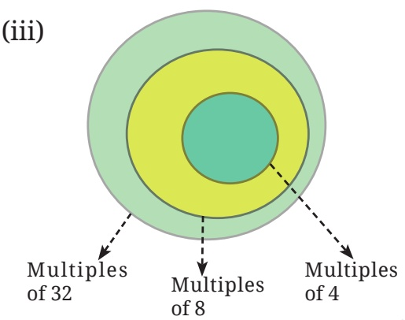
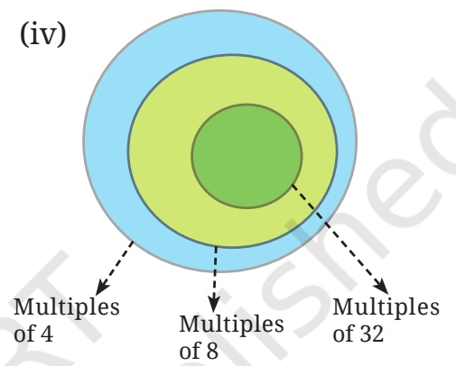

(i)

(ii)

## SUMMARY

„ We explored and learnt various properties of divisibility —

• If a is divisible by b, then all multiples of a are divisible by b.

• If a is divisible by b, then a is divisible by all the factors of b.

• If a divides m and a divides n, then a divides m + n and m – n.

If a is divisible by b and is also divisible by c, then a is divisible by the LCM of b and c.

We learnt shortcuts to check divisibility by 3, 9 and 11, and why they work.

Through all this we were exposed to the power of mathematical thinking and reasoning, using algebra, visualisation, examples and counterexamples.