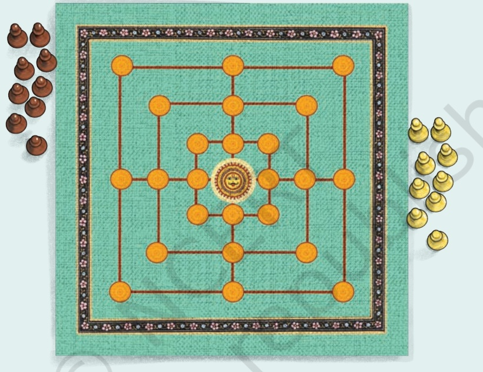

Navakankari, also known as Sālu Mane Āṭa, Chār-Pār, or Navkakri, is a traditional Indian board game that is the same as ‛Nine Men’s Morris’ or ‛Mills in the West’. It is a strategy game for two players where the goal is to form lines of three pawns to eliminate the opponent’s pawns or block their movement.

## Gameplay

1. Each player starts with 9 pawns. The players take turns in placing their pawns on the marked intersections. An intersection can have at most one pawn.

2. Once all the pawns are placed, the players take turns to move one of their pawns to adjacent empty intersections to form lines of three. The line can be horizontal or vertical.

3. Once a player makes a line with their pawns they can remove any one of the opponent’s pawns as long as it is not a part of one of their lines.

A player wins if the opponent has less than 3 pawns or is unable to make a move.

