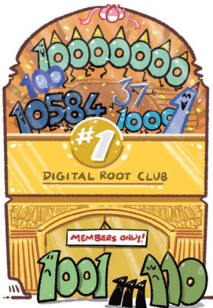

(ii) Digital roots → 4, 8, 3, 7, 2, 6, 1, 5, 9; 4, 8, 3; ......

(iii) Digital roots → 6, 3, 9; 6, 3, 9; ......

I’m made of digits, each tiniest and odd, No shared ground with root #1—how odd! My digits count, their sum, my root — All point to one bold number’s pursuit— The largest odd single-digit I proudly claim. What’s my number? What’s my name?

**Ans.** 11,11,11,111

Eleven crore eleven lakh eleven thousand one hudred eleven.

## Page No. 131

## Figure it Out

1. The digital root of an 8-digit number is 5. What will be the digital root of 10 more than that number?

**Ans.** Digital root is 5 + 1 = 6

One such number is 40000001

Try for more numbers.

2. Write any number. Generate a sequence of numbers by repeatedly adding 11. What would be the digital roots of this sequence of numbers? Share your observations.

**Ans.** Let the number be 10.

The sequence of numbers obtained by repeatedly adding 11 are 10, 21, 32, 43, 54, … .

The digital roots of this sequence are

$$
10 \rightarrow 1 + 0 = 1
$$

$$
6 5   \rightarrow   2
$$

$$
21 \rightarrow 2 + 1 = 3
$$

$$
7 6   \rightarrow   4
$$

$$
32 \rightarrow 3 + 2 = 5
$$

$$
8 7   \rightarrow   6
$$

$$
43 \rightarrow 4 + 3 = 7
$$

$$
9 8   \rightarrow   8
$$

$$
54 \rightarrow 5 + 4 = 9
$$

$$
1 0 9   \rightarrow   1
$$

$$
1 2 0   \rightarrow   3
$$