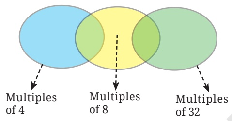
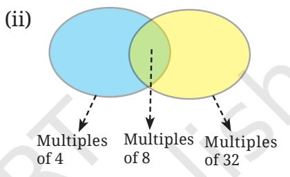
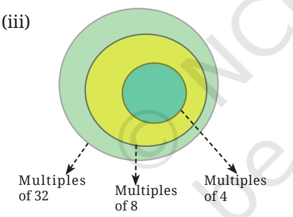
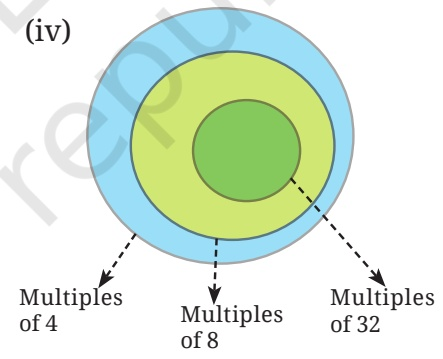

$( 2 \times 3 \times 4 = 2 4 ) .$

Product of 5 consecutive integers.

The product must be a multiple of 120 $( 2 \times 3 \times 4 \times 5 )$

15. Solve the cryptarithms —

(i) $\mathrm{EF} \times \mathrm{E} = \mathrm{GGG} \quad (\mathrm{ii}) \mathrm{WOW} \times \mathrm{5} = \mathrm{MEOW}$

**Ans.**

(i) $\mathrm{E}=3,\mathrm{F}=7,\mathrm{G}=1$

(ii) $W = 5, \; 0 = 7, \; M = 2, \; E = 8$

16. Which of the following Venn diagrams captures the relationship between the multiples of 4, 8, and 32?

(i)

Ans. (iv)

