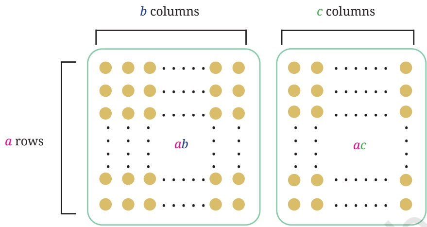

$$
\overbrace { a \left( b + c \right) } ^ { \frown } = a b + a c
$$

This property can be visualised nicely using a diagram:

$$
a \left( b + c \right)
$$

This is called the **distributive property** of multiplication over addition. Using the identity $a(b + c) = ab + ac$ with $a = 23,   b = 27$ , and $c = 1$ , we have

$$
23(27 + 1) = 23 \times 27 + \boxed{23}
$$

Remember that here, a $( b   +   c )$ and $23   (27   +   1)$ mean $a \times ( b + c ) ,$ , and $2 3 \times ( 2 7 \pm 1 )$ , respectively. We usually skip writing the $^ { \circ } \times ^ { \circ }$ symbol before or after brackets, just as in the case of expressions like 5a, xy, etc.

$( a + b )$ c using the distributive property as follows —

$$
\begin{array} { r l } & { \left( a + b \right) c = c \left( a + b \right) \left( \mathrm { c o m m u t a t i v i t y ~ o f ~ m u l t i p l i c a t i o n } \right) } \\ & { \quad = c a + c b \left( \mathrm { d i s t r i b u t i v i t y } \right) } \\ & { \quad = a c + b c \left( \mathrm { c o m m u t a t i v i t y ~ o f ~ m u l t i p l i c a t i o n } \right) } \end{array}
$$

We can use the distributive property to find, in general, how much a product increases if one or both the numbers in the product are increased by 1. Suppose the initial two numbers are a and b. If one of the numbers, say b, is increased by 1, then we have—

$$
\overbrace { a   (   b + 1 ) } ^ { \overbrace { a   (   b + 1 ) } ^ { \overbrace { a   (   b + 1 ) } ^ { \overbrace { a   (   a ) } ^ { \overbrace { a   (   a ) } ^ { \overbrace { a   (   a ) } ^ { \overbrace { a   (   a ) } ^ { \overbrace { a   (   a ) } ^ { \overbrace { a   (   a ) } ^ { \overbrace { a   (   a ) } ^ { \overbrace { a   (   a ) } ^ { \overbrace { a   (   a ) } ^ { \overbrace { a   (   a ) } ^ { \overbrace { a   (   a ) } ^ { \overbrace { a   (   a ) } ^ { \overbrace { a } } ^ { \overbrace { a } } ^ { \overbrace { a } } ^ { \overbrace { a } } ^ { \overbrace { a } } ^ { \overbrace { a } } ^ { \overbrace { a } } ^ { \overbrace { a } } ^ { \overbrace { a } } ^ { \overbrace { a } } ^ { \overbrace { a } } ^ { \overbrace { a } } ^ { \overbrace { a } } ^ { \overbrace { a } } ^ { \overbrace { a } } ^ { \overbrace { a } } ^ { \overbrace { a } } ^ { a } ^ { \overbrace { a } } ^ { \overbrace { a } } ^ { a } ^ { \overbrace { a } } ^ { a } ^ { \overbrace { a } } ^ { a } ^ { \overbrace { a } } ^ { a } ^ { \overbrace { a } } ^ { a } ^ { \overbrace { a } } ^ { a } ^ { \overbrace { a } } ^ { a } ^ { \overbrace { a } } ^ { a } ^ { \overbrace { a } } ^ { a } ^ { \overbrace { a } } ^ { a } ^ { a } } ^ { a } ^ { \overbrace { a } } ^ { a } ^ { a } } ^ { a } ^ { a } } ^ { a } } ^ { a } } ^ { a } = a b \times \boxed { a } } ^ { a } ^ { a } } ^ { a } } = a b \overbrace { a b \times \boxed { a } } ^ { a } ^ { a } } = a b \overbrace \overbrace { a \overbrace { a \overbrace { a \over \over { a \over ( ( ) ) } } ^ { a } ^ { a \overbrace { a \overbrace \over { a \over ( ) } } ^ { a } ^ { a \overbrace { a \over \over { a \over } } ^ { a } } ^ { a } ^ { a \overbrace { a } } ^ { a } ^ { \overbrace \overbrace { a } } ^ { a } ^ { a \overbrace } { a } ^ { a \overbrace } } ^ { a } ^ { a \overbrace { a } } ^ { a \overbrace } ^ { a } } ^ { a } ^ { a \overbrace } } ^ { a } ^ { a } } = a b \overbrace \overbrace \overbrace \overbrace { a \over \over { a \over \over { a \over \over { a \over ( \over ( ) ) } } } ^ { a } ^ { a } ^ { a } } ^ { a } = a \overbrace \over \over \over \over { a \over \over \over { a \over \over \over { a \over \over { a ( \over ( ) ( ) } } } ^ { a } ^ { a } } ^ { a } ^ = a \over \over \over \over \over \over \over { a \over \over \over { a \over
$$

Now let us see what happens if both numbers in a product are increased by 1. If in a product ab, both a and b are increased by 1, then we obtain (a + 1) (b + 1).