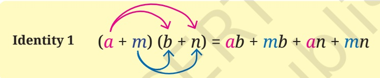
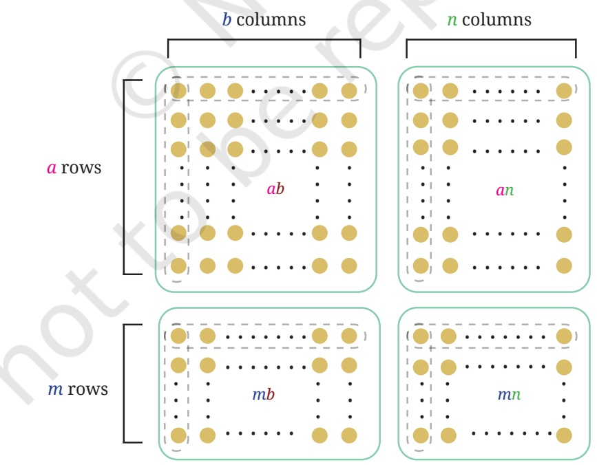

numbers could be any integers. Mathematical statements that express the equality of two algebraic expressions, such as

$$
a \left( b + 8 \right) = ab + 8a,
$$

$$
( a + 1 )   ( b - 1 ) = a b + b - a - 1 ,   { \mathrm { e t c . } } ,
$$

are called **identities.**

## ？ By how much will the product of two numbers change if one of the numbers is increased by m and the other by n?

If a and b are the initial numbers being multiplied, they become $a + m$ and $b + n$

$$
\begin{aligned}\left( a + m \right) \left( b + n \right) &= (a + m)b + (a + m)n \\&= ab + mb + an + mn.\end{aligned}
$$

The increase is $a n + b m + m n$

Notice that the product is the sum of the product of each term of $( a + m )$ with each term of $( b + n )$

This identity can be visualised as follows —

$$
\left( a + m \right) \left( b + n \right)
$$