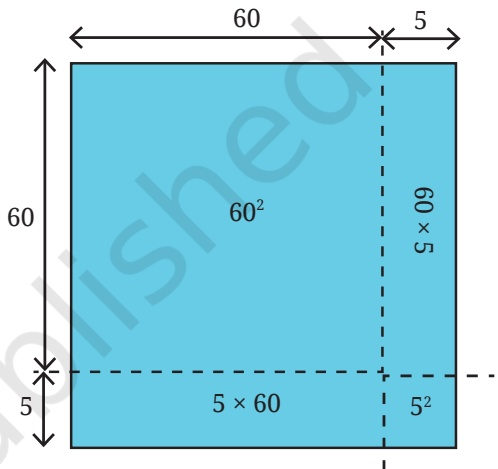
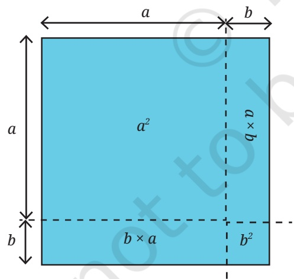

## 6.2 Special Cases of the Distributive Property

## Square of the Sum/Difference of Two Numbers

？ The area of a square of sidelength 60 units is 3600 sq. units (602) and that of a square of sidelength 5 units is 25 sq. units (52). Can we use this to find the area of a square of sidelength 65 units?

A square of sidelength 65 can be split into 4 regions as shown in the figure—a square of sidelength 60, a square of sidelength 5, and two rectangles of sidelengths 60 and 5. The area of the square of sidelength 65 is the sum of the areas of all its constituent parts. Can you find the areas of the four parts in the figure above?

We get

$$
\begin{array} { r l } { 6 5 ^ { 2 } \stackrel { \circ } { = } ( 6 0 + 5 ) ^ { 2 } = 6 0 ^ { 2 } + 5 ^ { 2 } + 2 \times ( 6 0 \times 5 ) . \quad } & { } \\ { = 3 6 0 0 + 2 5 + 6 0 0 = 4 2 2 5 \quad \mathrm { s q . \quad u n i t s } . } \end{array}
$$

Let us multiply (60 + 5) × (60 + 5) using the distributive property.

$$
\begin{aligned}(60 + 5) \times (60 + 5) &= 60 \times 60 + 5 \times 60 + 60 \times 5 \div 5 \times 5 \\&= 60^2 + 2 \times (60 \times 5) + 5^2,\end{aligned}
$$

？ What if we write $6 5 ^ { 2 }$ as $(30 + 35)^{2}$ or $( \bar { 5 } 2   \pm   1 3 ) ^ { 2 } ?$ Draw the figures and check the area that you get.

Let us look at the general expression for the square of sum of two numbers, $\overline{(a+b)^{2}}.$

Using the distributive property, $(a + b)^{2}$ can be expanded as

$$
\overbrace{(a^{+}b) \times (a^{+}b)}^{ 乙一个 } = a \times a + a \times b + b \times a + b \times b,
$$

as we had already seen in Example 2.

**Identity 1A**

$$
(a+b)^{2}=a^{2}+2ab+b^{2}
$$

？ If a and b are any two integers, is $( a + b ) ^ { 2 }$ always greater than $a ^ { 2 }   + b ^ { 2 } ?$ If not, when is it greater?