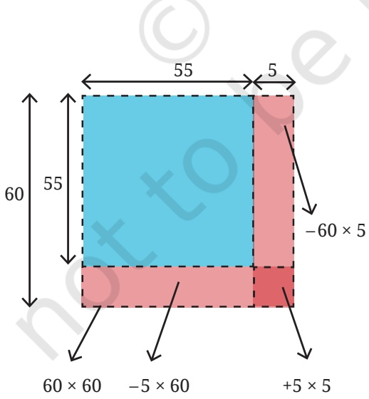

？ Use Identity 1A to write the expressions for the following.

(i) $( m + 3 ) ^ { 2 }$ (ii) $( 6 + p ) ^ { 2 }$

## ？ Expand $( 6 x + 5 ) ^ { 2 }$

| Using the Distributive Property | Using the Identity |
| --- | --- |
| (6x + 5)2 = (6x + 5) (6x + 5) = (6x × 6x) + (5 × 6x) +(6x × 5) + 5 × 5 = (6x)2 + 2 (6x × 5) + 52 = 36x2 + 60x + 25. | (6x + 5)2 = (6x)2 + 52 + 2 × (6x × 5) = 36x2 + 25 + 60x. |

If you have difficulty remembering or using the general rule, you can just apply the distributive property to multiply and get the desired result.

？ Expand $( 3 j + 2 k ) ^ { 2 }$ using both the identity and by applying the distributive property.

？ Can we use $6 0 ^ { 2 } \: ( = 3 6 0 0 )$ and $5 ^ { 2 } \; ( { = } 2 5 )$ to find the value of $( 6 0 - 5 ) ^ { 2 }$ or $5 5 ^ { 2 } ?$ Let us approach this through geometry by drawing a square of side length 55 sitting inside a square of sidelength 60.

Area of a square of sidelength 55 is $(60 - 5)^{2} = 55^{2}$

We can get the area of the square of sidelength 55 by taking the area of the square of sidelength 60 and removing the areas of the two rectangles of sidelengths 60 and 5, i.e., $6 0 ^ { 2 } \mathrm { ~ - ~ } \bar { ( 6 0 } \mathrm { ~ \times ~ } 5 ) \mathrm { ~ - ~ } ( 5 \mathrm { ~ \times ~ } 6 0 )$ By doing this, we remove the area of the small square of sidelength 5 twice. What can we do with this expression to get the actual area?

We can add back the area of the square of sidelength 5 to this expression. That way, we are only subtracting this area once.