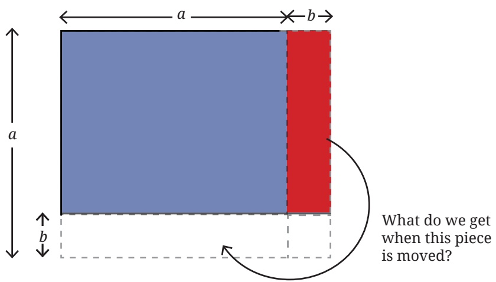
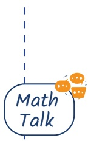

What do we get when this piece is moved?

## Hint:

Sridharacharya (750 CE) gave an interesting method to quickly compute the squares of numbers using Identity 1C! Consider the following modified form of this identity —

$$
a^{2}=(a+b)(a-b)+b^{2}
$$

## ？ Why is this identity true?

Now, for example, $3 1 ^ { 2 }$ can be found by taking $a \equiv 3 1$ and $b = 1$

$$
\begin{aligned}31^{2} &= (31 + 1)(31 - 1) + 1^{2} \\&= 32 \times 30 + 1 \\&= 961.\end{aligned}
$$

$1 9 7 ^ { 2 }$ can be found by taking $a = 1 9 7 ,$ and $b = 3$

$$
\begin{aligned}197^{2} &= (197 + 3) (197 - 3) + 3^{2} \\&= 200 \times 194 + 9 \\&= 38809.\end{aligned}
$$

## Figure it Out

1. Which is greater: $( a - b ) ^ { 2 }$ or $( b - a ) ^ { 2 } ?$ Justify your answer.

2. Express 100 as the difference of two squares.

3. Find 4062, 722, 1452, $1 0 9 7 ^ { 2 } ,$ and $1 2 4 ^ { 2 }$ using the identities you have learnt so far.

4. Do Patterns 1 and 2 hold only for counting numbers? Do they hold for negative integers as well? What about fractions? Justify your answer.