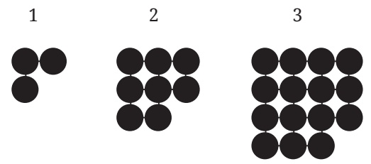
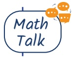

## 6.3 Mind the Mistake, Mend the Mistake

We have expanded and simplified some algebraic expressions below to their simplest forms.

(i) Check each of the simplifications and see if there is a mistake.

(ii) If there is a mistake, try to explain what could have gone wrong.

(iii) Then write the correct expression.

$$
\begin{array} { r l } & { - 3 p \left( - 5 p + 2 q \right) } \\ & { = - 3 p + 5 p - 2 q } \\ & { = p - 2 q } \end{array}
$$

2

$$
\begin{array} { r l } & { \quad 2 ( x - 1 ) + 3 ( x + 4 ) } \\ & { = 2 x - 1 + 3 x + 4 } \\ & { = 5 x + 3 } \end{array}
$$

3

$$
\begin{array} { r l } & { \quad y + 2 \left( y + 2 \right) } \\ & { = ( y + 2 ) ^ { 2 } } \\ & { = y ^ { 2 } + 4 y + 4 } \end{array}
$$

4

5

6

$$
{ \bf \Delta } _ { = 2 5 m ^ { 2 } + 3 6 n ^ { 2 } }
$$

$$
{ \bf \Gamma } _ { =   q ^ { 2 } -   4 q +   4 } ^ { ( -   q +   2 ) ^ { 2 } }
$$

$$
\begin{array} { r } { 3 a \left( 2 b \times 3 c \right) } \\ { = 6 a b \times 9 a c } \\ { = 5 4 a 2 b c } \end{array}
$$

7

$$
\begin{aligned}&\frac{1}{2}(10s - 6) + 3 \\=& 5s - 3 + 3 \\=& 5s\end{aligned}
$$

8

$$
= \frac { 5 w ^ { 2 } + 6 w } { 1 1 w ^ { 2 } }
$$

9

$$
\begin{array}{l}2a^{3}+3a^{3}+6a^{2}b^{2}\\+6ab^{2}\\=5a^{3}+12a^{2}b^{2}\end{array}
$$

10

$$
\begin{array} { r l } & { \left[ \begin{array} { l } { - ( x + 2 ) ( x + 5 ) } \\ { = ( x + 2 ) x + ( x + 2 ) 5 } \\ { = x ^ { 2 } + 2 x + 5 x + 1 0 } \\ { = x ^ { 2 } + 7 x + 1 0 } \end{array} \right] } \end{array}
$$

11

$$
\begin{array}{l}(a + 2)(b + 4) \\= ab + 8\end{array}
$$

12

$$
\begin{array} { c } { a b ^ { 2 } + a ^ { 2 } b + a ^ { 2 } b ^ { 2 } } \\ { = a b \left( a + b + a b \right) } \end{array}
$$

## 6.4 This Way or That Way, All Ways Lead to the Bay

Observe the pattern in the figure below. Draw the next figure in the sequence. How many circles does it have? How many total circles are there in Step 10? Write an expression for the number of circles in Step k.

3

There are many ways of interpreting this pattern. Here are some possibilities: