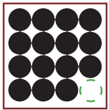
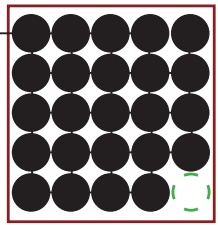
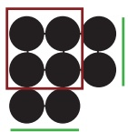
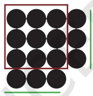
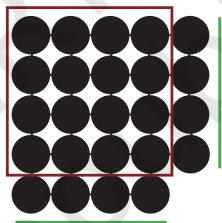
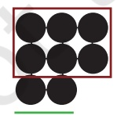
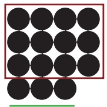
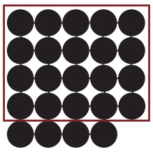

= (2 + 1)2 – 1

## Method 1

Step 1

Step 2

32 – 1

Step 3

$$
2 ^ { 2 } - 1
$$

$$
= ( 1 + 1 ) ^ { 2 } - 1
$$

42 – 1

= (3 + 1)2 – 1

Step 4

52 – 1

= (4 + 1)2 – 1

Step k

$$
( k + 1 ) ^ { 2 } - 1
$$

## Method 2

Step 1

Step 2

Step 3

$$
1 + 2 \times 1
$$

$$
2 ^ { 2 } + 2 \times 2
$$

Step 4

32 + 2 × 3

Step k

$$
= 1 ^ { 2 } + 2 \times 1
$$

= 22 + 2 × 2

= 32 + 2 × 3

42 + 2 × 4

$$
4^{2} + 2 \times 4
$$

$$
\boldsymbol { k } ^ { 2 } + 2 \times \boldsymbol { k }
$$

## Method 3

Step 1

Step 2

1 × 2 + 1

2 × 3 + 2

Step 3

$$
1 \times (1 + 1) + 1
$$

= 2 × (2 + 1) + 2

3 × 4 + 3

= 3 × (3 + 1) + 3

Step 4

4 × 5 + 4

= 4 × (4 + 1) + 4

Step k

$$
k \times ( k + 1 ) + k
$$