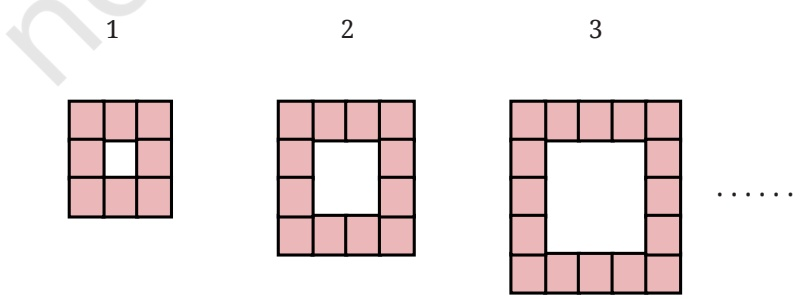
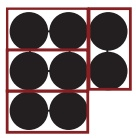
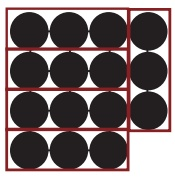
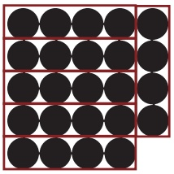

= 2 × (2 + 2)

## Method 4

Step 1

Step 2

2 × 4

Step 3

Step 4

3 × 5

Step k

$$
\begin{array} { r l } {  { 1 \times 3 } } \\ { = 1 \times ( 1 + 2 ) } \end{array}
$$

= 3 × (3 + 2)

4 × 6

= 4 × (4 + 2)

Does your method match any of these, or is it different? Each expression that we have identified appears different, but are they really different? Since they describe the same pattern, they should all be the same. Let us simplify each expression and find out.

$$
\begin{array} { c } { ( k + 1 ) ^ { 2 } - 1 } \\ { = k ^ { 2 } + 1 + 2 k - 1 } \\ { = k ^ { 2 } + 2 k } \end{array}
$$

$$
\begin{array} { r } { k ^ { 2 } + 2 \times k } \\ { = k ^ { 2 } + 2 k } \end{array}
$$

$$
\begin{array} { c } { k \times ( k + 1 ) + k } \\ { = k ^ { 2 } + k + k } \\ { \supset \ldots = k ^ { 2 } + 2 k } \end{array}
$$

$$
\stackrel{k \times (k + 2)}{= k^2 + 2k}
$$

When carried out correctly, all methods lead to the same answer; $\mathbf { k } ^ { 2 } + 2 k .$ The expression $k^{2}  和  2\bar{k}$ gives the number of circles at Step k of this pattern.

In Mathematics, there are often multiple ways of looking at a pattern, and different ways of approaching and solving the same problem. Finding such ways often requires a great deal of creativity and imagination! While one or two of the ways might be your favourite(s), it can be amusing and enriching to explore other ways as well.

？ Use this formula to find the number of circles in Step 15.

? Consider the pattern made of square tiles in the picture below.

2

3