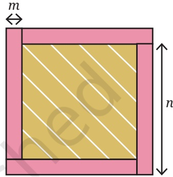
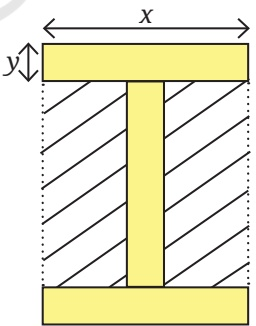
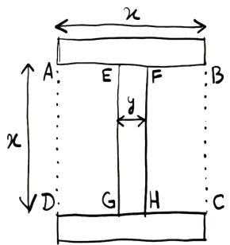
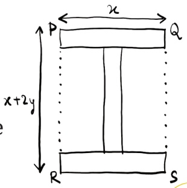

？ How many square tiles are there in each figure?

How many are there in Step 4 of the sequence? What about Step 10?

？ Write an algebraic expression for the number of tiles in Step n. Share your methods with the class. Can you find more than one method to arrive at the answer?

？ Find the area of the (interior) shaded region in the figure below. All four rectangles have the same dimensions. m

**Tadang’s method:**

The total region is a square of side (m + n) with an area $( m + n ) ^ { 2 }$

Subtracting the area of four rectangles from the total area will give the area of the interior shaded region. That is, $( m + n ) ^ { 2 } - 4 m n$

## Yusuf’s method:

The shaded region is a square with sidelength (n – m). So, its area is $( n - m ) ^ { 2 } .$

By expanding both expressions,

check that $(m + n)^{2} - 4mn = (n - m)^{2}$ .

? Find out the area of the region with slanting lines in the figure. All three rectangles have the same dimensions (Fig. 1).

Fig. 1

**Anusha’s method:**

Required area = Area (ABCD) – Area (EFGH)

Area of ABCD = x2.

Area of EFGH = xy.

Required $\mathrm{arc} \underline{a} = x^{2} - \overline{x} y.$

**Vaishnavi’s method:**

$$
\begin{array} { l } { { \mathrm { Q S } = y + x + y } } \\ { { \quad = x + 2 y . } } \end{array}
$$

Area of $PQSR = x(x + 2y)$

Required area = Area of PQSR – (area of the three rectangles)

$$
x \left( x + 2y \right) - 3xy.
$$

