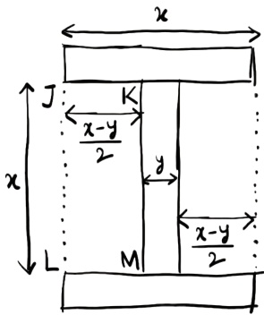
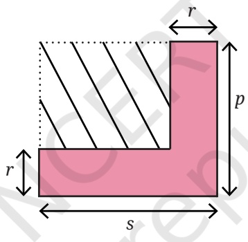

**Aditya’s method:**

The required area is 2 times the area of JKLM.

$$
\mathrm{JK} = \frac{X - y}{2}, \mathrm{KM} = x
$$

Area $( \mathrm { { J K M L } } ) = x \left( { \frac { x - y } { 2 } } \right)$

Required area = 2 × Area of JKML = 2x (x – y) 2 = x (x – y).

? By expanding the expressions, verify that all three expressions are equivalent. If $x = 8  and  y = 3.$ , find the area of the shaded region.

？ Write an expression for the area of the dashed region in the figure below. Use more than one method to arrive at the answer. Substitute $p = 6,   r = 3.5,$ , and $s = 9$ , and calculate the area.

## Figure it Out

1. Compute these products using the suggested identity.

(i) $4 6 ^ { 2 }$ using Identity 1A for $( a + b ) ^ { 2 }$

(ii) $3 9 7 \times 4 0 3$ using Identity 1C for $\left( a + b \right) \left( a - b \right)$

(iii) $9 1 ^ { 2 }$ using Identity 1B for $( a - b ) ^ { 2 }$

(iv) $4 3 \times 4 5$ using Identity 1C for $( a + b )   ( a - b )$

2. Use either a suitable identity or the distributive property to find each of the following products.

(i) $(p - 1)(p + 11)$

(ii) $( 3 a - 9 b ) ( 3 a + 9 b )$

(iii) $-(2y+5)\left ( 3y+4 \right )$

(iv) $( 6 x + 5 y ) ^ { 2 }$

(v) $( 2 X   -   { \frac { 1 } { 2 } } ) ^ { 2 }$

$( 7 p ) \times ( 3 r ) \times ( p + 2 )$