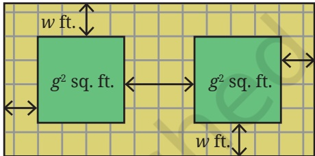
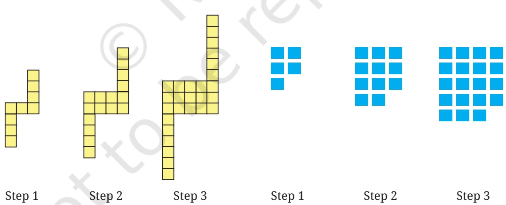

Step 2

sets of numbers. What pattern do you notice? How do we write this as an algebraic equation? Expand both sides of the equation to check that it is a true identity.

8. What is the algebraic expression describing the following steps — add any two numbers. Multiply this by half of the sum of the two numbers? Prove that this result will be half of the square of the sum of the two numbers.

9. Which is larger? Find out without fully computing the product.

(i) $1 4 \times 2 6 \; \mathrm { o r } \; 1 6 \times 2 4$

(ii) $2 5 \times 7 5$ or $2 6 \times 7 4$

10. A tiny park is coming up in Dhauli. The plan is shown in the figure. The two square plots, each of area $g ^ { 2 }$ sq. ft., will have a green cover. All the remaining area is a walking path w ft. wide that needs to be tiled. Write

an expression for the area that needs to be tiled.

11. For each pattern shown below,

(i) Draw the next figure in the sequence.

(ii) How many basic units are there in Step 10?

(iii) Write an expression to describe the number of basic units in Step y.

Step 3