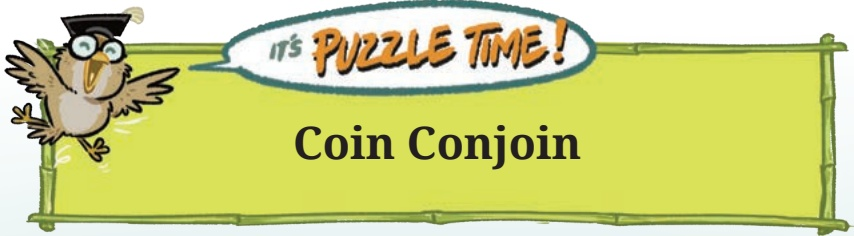
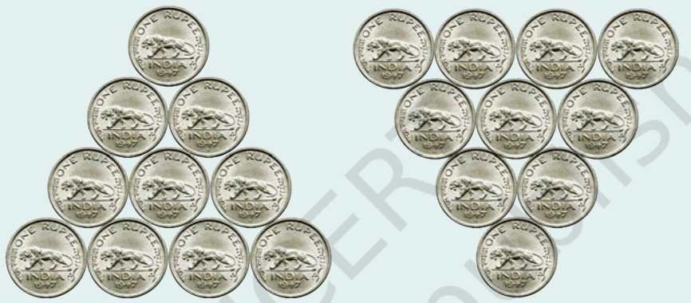

# Coin Conjoin

Arrange 10 coins in a triangle as shown in the figure below on the left. The task is to turn the triangle upside down by moving one coin at a time. How many moves are needed? What is the minimum number of moves?

A triangle of 3 coins can be inverted (turned upside down) with a single move, and a triangle of 6 coins can be inverted by moving 2 coins.

The 10-coin triangle can be flipped with just 3 moves; did you figure out how? Find out the minimum possible moves needed to flip the next bigger triangle having 15 coins. Try the same for bigger triangular numbers.

Is there a simple way to calculate the minimum number of coin moves needed for any such triangular arrangement?

