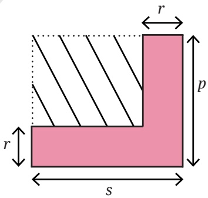

? How many square tiles are there in each figure?

**Ans.**

| Fig. No. | Number of square | Pattern |
| --- | --- | --- |
| 1 | 8 | 32 - 12 |
| 2 | 12 | 42 - 22 |
| 3 | 16 | 52 - 32 |
| . | . | . |
| . | . | . |
| . | . | . |
| . |  |  |

How many are there in Step 4 of the sequence? What about Step 10?

**Ans.** Step 4 → Number of squares $6^{2} - 4^{2}$

Step 10 → Number of squares → $12^{2} = 10^{2}$

？ Write an algebraic expression for the number of tiles in Step n. Share your methods with the class. Can you find more than one method to arrive at the answer?

**Ans.** $( n + 2 ) ^ { 2 } - n ^ { 2 }$

**Page No. 154**

？ Write an expression for the area of the dashed region in the figure below. Use more than one method to arrive at the answer. Substitute $p = 6 ,$ $r = 3 . 5$ , and $s = 9$ , and calculate the area.

**Ans.**