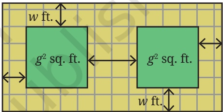

9. Which is larger? Find out without fully computing the product.

(i) $1 4 \times 2 6 \; \mathrm { o r } \; 1 6 \times 2 4$

(ii) $2 5 \times 7 5 \; \mathrm { o r } \; 2 6 \times 7 4$

**Ans.**

(i) Let $a = 14 \times 26   and   b = 16 \times 24$

$$
\begin{aligned}\operatorname{Now} a &= (16 - 2) (24 + 2) \\&= 16 \times 24 + 16 \times 2 - 2 \times 24 - 2 \times 2 \\&= b + (32 - 48 - 4) \\&= b - 20\end{aligned}
$$

Hence, $b > a \mathrm{~or~} 16 \times 24 > 14 \times 26$

(ii) Let $a = 25 \times 75   and   b = 26 \times 74$

Now $a = (26 - 1)(74 + 1) = 26 \times 74 + 26 - 74 - 1$ = b – 49

Hence b > a or 26 × 74 > 25 × 75

10. A tiny park is coming up in Dhauli. The plan is shown in the figure. The two square plots, each of area $g ^ { 2 }$ sq. ft., will have a green cover. All the remaining area is a walking path w ft. wide that needs to be tiled. Write an expression for the area that needs to be tiled.

**Ans.** Length of rectangular park $w+g+2w+g+w=(2g+4w)$ ft.

Breadth of rectangular park $w + w + g = (g + 2w)$ ft.

Area of $\mathrm{park} = (2g + 4w)(g + 2w) \mathrm{~sq.~ft.}$

$$
= 2 g ^ { 2 } + 8 w ^ { 2 } + 8 w g \mathrm { s q . } \mathrm { f t } .
$$

Area of the two $\mathrm{squares} = 2g^2 \mathrm{sq}.$ ft.

So, Area to be tiled $(2g+4w)(g+2w)-2g^{2}$ $= 8 w ( w + g ) \mathrm { s q . f t . }$

11. For each pattern shown below,

(i) Draw the next figure in the sequence.

(ii) How many basic units are there in Step 10?

(iii) Write an expression to describe the number of basic units in