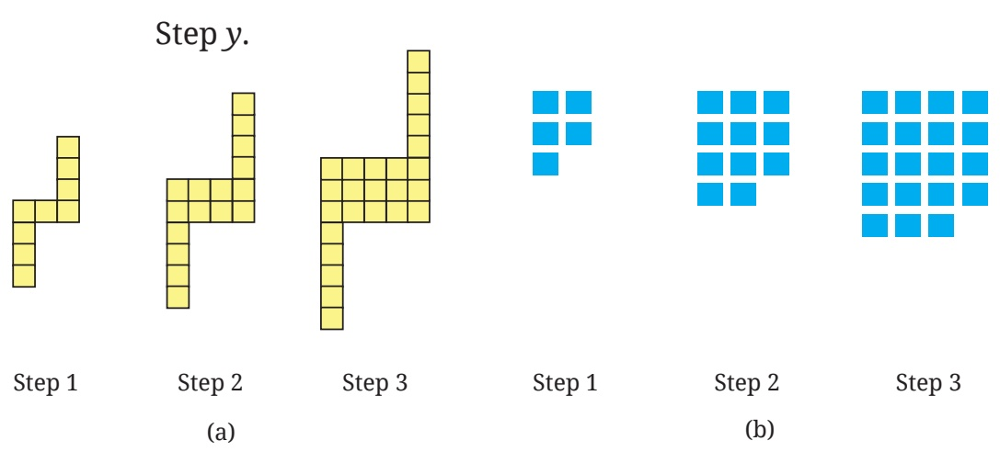
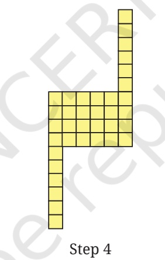
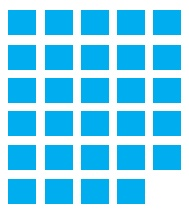

Step 2

Step 1

(i) (a) Draw yourself Here Step 1, Total units $(2 + 1)^{2} = (3)^{2} = 9$ Step 2, Total units $= ( 2 + 2 ) ^ { 2 } = ( 4 ) ^ { 2 } = 1 6$ Step 3, Total unit $s = (2 + 3)^{2} = (5)^{2} = 25$ Then next figure

T $total  = (2 + 4)^{2} = (6)^{2} = 36$

(b) Step 1, we have $2 ^ { 2 } + 1 = 5$ Step 2, we have $3 ^ { 2 } + 2 = 1 1$ Step 3, we have $4 ^ { 2 } + 3 = 1 9$ Then next Step, we have $5 ^ { 2 } + 4 = 2 9 .$

Step 4