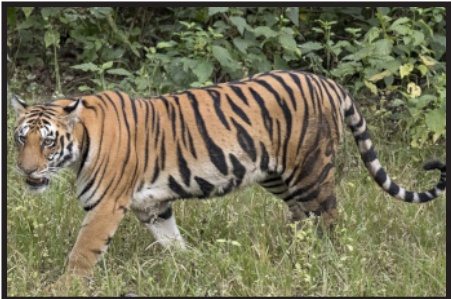
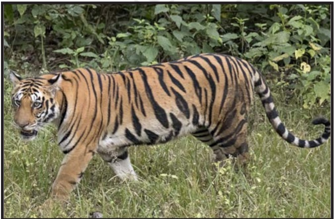

## 7.1 Observing Similarity in Change

We are all familiar with digital images. We often change the size and orientation of these images to suit our needs. Observe the set of images below—

Image A

Image B

Image C

Image D

Image E

We can see that all the images are of different sizes.

？ Which images look similar and which ones look different? Images (A, C, and D) look similar, even though they have different sizes.