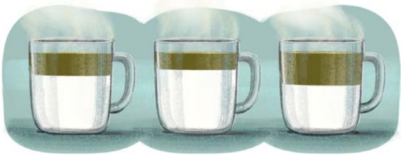

Why is this coffee stronger?

And when they want ‘lighter’ filter coffee, he mixes 10 mL of coffee and 40 mL of milk, making the ratio 10 : 40.

Why is this coffee lighter?

The following table shows the different ratios in which Manjunath mixes coffee decoction with milk. Write in the last column if the coffee is stronger or lighter than the regular coffee.

| Coffee Decoction (in mL) | Milk (in mL) | Regular/Strong/Light |
| --- | --- | --- |
| 300 | 600 |  |
| 150 | 500 |  |
| 200 | 400 |  |
| 24 | 56 |  |
| 100 | 300 |  |

## Figure it Out

1. Circle the following statements of proportion that are true.

(i) 4 : 7 :: 12 : 21 (ii) 8 : 3 :: 24 : 6

(iii) 7 : 12 :: 12 : 7 (iv) 21 : 6 :: 35 : 10

(v) 12 : 18 :: 28 : 12 (vi) 24 : 8 :: 9 : 3

2. Give 3 ratios that are proportional to 4 : 9.

3. Fill in the missing numbers for these ratios that are proportional to 18 : 24.

3 : \_ 12 : \_ 20 : \_ 27 : \_