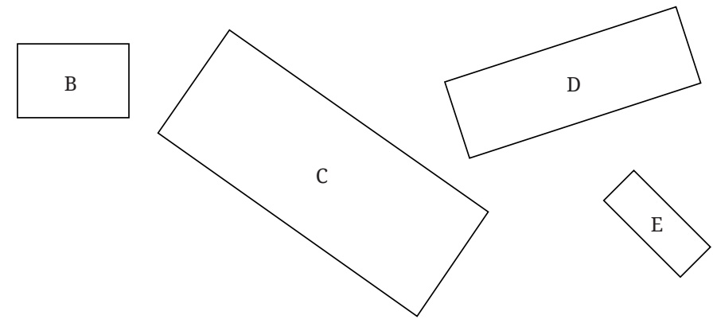
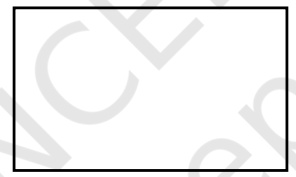
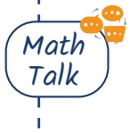
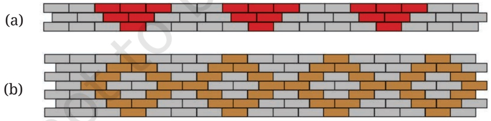

4. Look at the following rectangles. Which rectangles are similar to each other? You can verify this by measuring the width and height using a scale and comparing their ratios.

B

C

D

E

5. Look at the following rectangle. Can you draw a smaller rectangle and a bigger rectangle with the same width to height ratio in your notebooks? Compare your rectangles with your classmates’ drawings.

Are all of them the same? If they are different from yours, can you think why? Are they wrong?

Math Talk

6. The following figure shows a small portion of a long brick wall with patterns made using coloured bricks. Each wall continues this pattern throughout the wall. What is the ratio of grey bricks to coloured bricks? Try to give the ratios in their simplest form.

(a)

(b)

