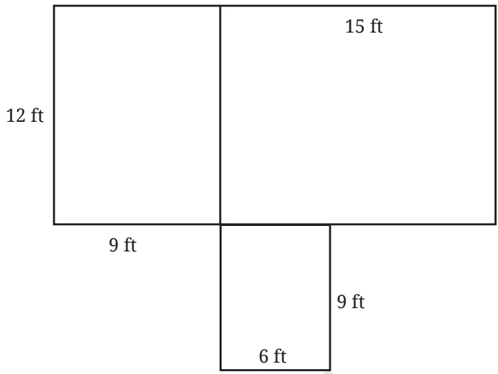

separates two rooms. To build a wall of 10-feet, he requires approximately 1450 bricks. How many bricks would he need to build the house? Assume all walls are of the same height and thickness.

？ Puneeth’s father went from Lucknow to Kanpur in 2 hours by riding his motorcycle at a speed of 50 km/h. If he drives at 75 km/h, how long will it take him to reach Kanpur? Can we form this problem as a proportion—

$$
50:2:75:
$$

Would it take Puneeth’s father more time or less time to reach Kanpur? Think about it.

Even though this problem looks similar to the previous problems, it cannot be solved using the Rule of Three!

The time of travel would actually decrease when the speed increases. So this problem cannot be modelled as 50 : 2 :: 75 : \_\_.

？ **Activity 2:** Go to the market and collect the prices of different sizes of shampoo containers of the same shampoo and create a table like the one given below. See if the volume of shampoo is proportional to the price.

| Container | Volume | Price |
| --- | --- | --- |
| Sachet | 6 mL | ₹2 |
| Small Bottle | 180 mL | ₹154 |
| Medium Bottle | 340 mL | ₹276 |
| Large Bottle | 1000 mL | ₹540 |