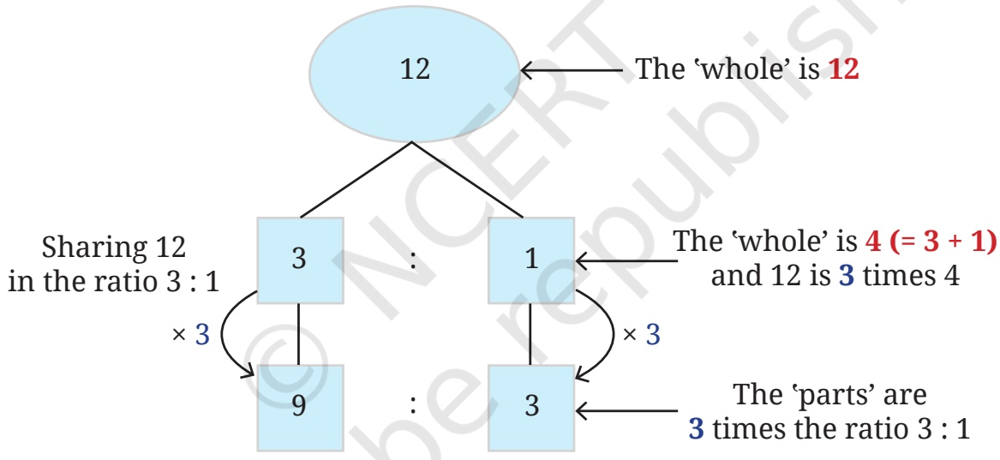

The ratio of the counters of your partner to yours is 5 : 7.

? Now, if you want to share the counters between the two of you in the ratio of 3 : 1, how many counters would each of you get?

Share the counters in different ways and see which combination is in the ratio 3 : 1.

One way to share the counters in the ratio of 3 : 1 is as follows —

1. Your partner takes 3 counters and you take 1 counter. There are now 8 counters left.

2. Your partner takes 3 more counters and you take 1 more counter. There are now 4 counters left.

3. Your partner takes 3 more counters and you take 1 more counter. There are no more counters left.

So, your partner gets 9 counters in total and you get 3 counters.

When we divide 12 counters in the ratio of 3 : 1 between two people, one gets 9 counters and the other gets 3 counters.

？ Now, if you want to share 42 counters between the two of you in the ratio of 4 : 3, how will you do it?

Using the same procedure would take a long time! There is a simpler way to share the whole with parts in a specified ratio.

You need to divide 42 into groups such that your partner gets 4 groups and you get 3 groups.

## What is the size of each group?

If your partner gets 4 groups and you get 3 groups, the total number of groups is 7. So, the size of each group is 42 ÷ 7 = 6.

Multiplying the number of groups by the size of each group, your partner gets 24 counters and you get 18 counters, when you share 42 counters in the ratio of 4 : 3.