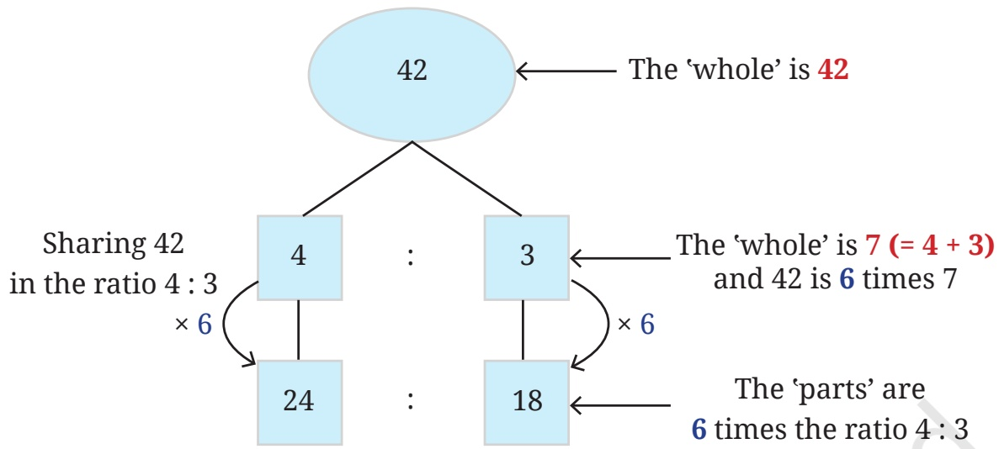

In general, when we want to divide a quantity, say x, in the ratio m : n, we do the following:

1. We need to split x into groups such that it can be divided into two parts where the first part has m groups and the second part has n groups.

2. But what is the size of each group? This can be found out by dividing x by the number of groups. The number of groups are $m + n .   \mathsf { S o } ,$ the size of each group is $\frac { X } { m + n }$

3. So, the first part has $\frac{m \times \frac{X}{m + n}}{}$ objects and the second part has $n \times { \frac { x } { m + n } }$ objects.

Thus, if we want to divide a quantity x in the ratio of m: n, then the parts will be $m \times \frac{x}{m \mp n}$ and $n \times \frac{x}{m + n}$ . We see that

$$
m \times \frac{x}{m + n} : n \times \frac{x}{m + n} : : m : n.
$$

## ？ Example 11: Prashanti and Bhuvan started a food cart business near their school. Prashanti invested ₹75,000 and Bhuvan invested ₹25,000. At the end of the first month, they gained a profit of ₹4,000. They decided that they would share the profit in the same ratio as that of their investment. What is each person’s share of the profit?

The ratio of their investment is 75000 : 25000.

Reducing this ratio to its simplest form, we get 3 : 1.

3 + 1 is 4 and dividing the profit of 4000 by 4, we get 1000.

So, Prashanti’s share is $3 \times 1 0 0 0$ and Bhuvan’s share is $1 \times 1 0 0 0 .$

So, Prashanti would get ₹3,000 and Bhuvan would get ₹1,000 of the profit.

## ？ Example 12: A mixture of 40 kg contains sand and cement in the ratio of 3 : 1. How much cement should be added to the mixture to make the 4 ratio of sand to cement 5 : 2?