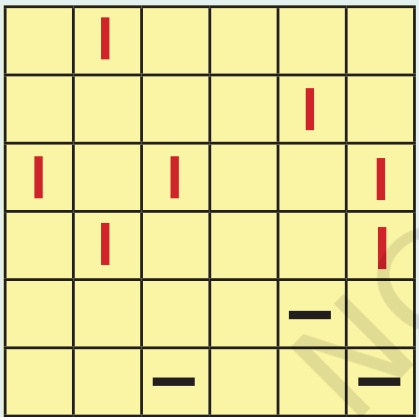
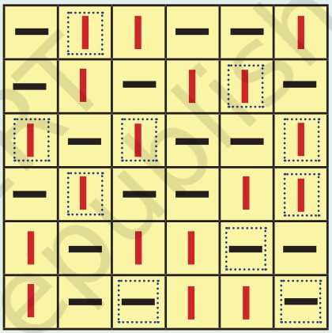
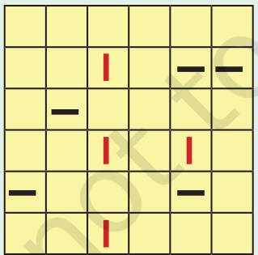
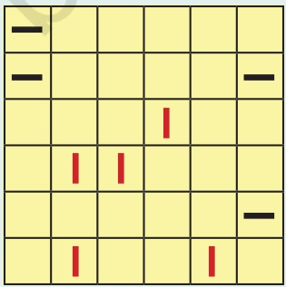
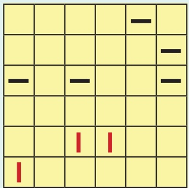

Binairo, also known as Takuzu, is a logic puzzle with simple rules. Binairo is generally played on a square grid with no particular size. Some cells start out filled with two symbols: here horizontal and vertical lines. The rest of the cells are empty. The task is to fill cells in such a way that:

1. Each row and each column must contain an equal number of horizontal and vertical lines.

2. More than two horizontal or vertical lines can’t be adjacent.

3. Each row is unique. Each column is unique.

Puzzle

Solution

Solve the following Binairo puzzles:

