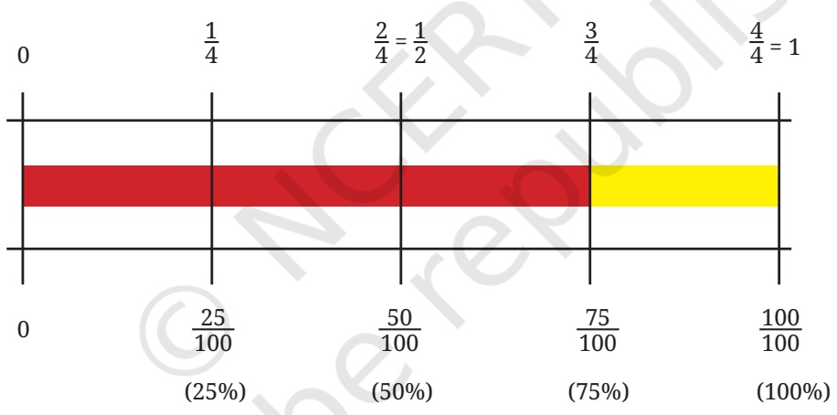

Explaining this in a different way: To express $\frac { 3 } { 4 }$ as a percentage, we need to find its equivalent fraction with 100 as the denominator. Two ways of going ahead are shown below.

Method 1

Method 2

$$
\begin{aligned}\frac{3}{4} &= \frac{3 \times 25}{4 \times 25} \\&= \frac{75}{100} = 75\%\end{aligned}
$$

$$
\begin{aligned}\frac{3}{4} &= \frac{x}{100} \cdot \\\frac{3}{4} \times 100 &= \frac{x}{100} \times 100 \\\left[  multiply both sides by   100 \right] \\x &= \frac{3}{4} \times 100 \\&= 75.\end{aligned}
$$

So, $\frac { 3 } { 4 }$ can be expressed as 75%.

Observe the following bar model diagram showing the equivalence between $\frac { 3 } { 4 }$ and 75%.

Can you tell what percentage of the colour was made using yellow?

？ **Example 2:** Surya won some prize money in a contest. He wants to save $\frac { 2 } { 5 }$ of the money to purchase a new canvas. Express this quantity as a percentage.

Try to understand the different methods for solving this problem, as shown below.

$$
\operatorname { M e t h o d 1 }
$$

$$
\begin{aligned}\frac{2}{5} &= \frac{20}{50} = \frac{40}{100} \\&= 40\%.\end{aligned}
$$

$$
\begin{aligned} & 故  \; \begin{aligned}\\ &\bmod 2 \\&\frac{2}{5} = \frac{x}{100}.\\ &\end{aligned}\\ &\quad x = \frac{2}{5} \times 100 = 40.\\ \end{aligned}
$$