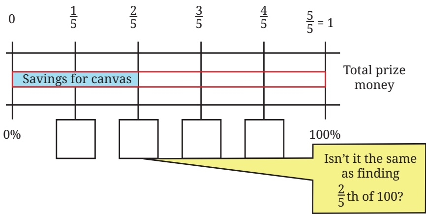

Try completing Method 3 by filling the boxes. Method 3

Several problems in mathematics can be approached and solved in different ways. While the method you came up with may be dear to you, it can be amusing and enriching to know how others thought about it.

A fraction is of a unit, while a percentage is per 100. Therefore, to express a fraction as a percentage, we can just multiply the fraction by 100.

## ？ Example 3: Given a percentage, can you express it as a fraction? For example, express 24% as a fraction.

Since a percentage is a fraction, 24% is the same as ${ \frac { 2 4 } { 1 0 0 } } \cdot$

We can find other equivalent forms of ${ \frac { 2 4 } { 1 0 0 } } = { \frac { 1 2 } { 5 0 } } = { \frac { 6 } { 2 5 } } = { \frac { 4 8 } { 2 0 0 } } \cdot$

In general, we can say that a percentage, z%, can be expressed by any of the fractions that are equivalent to ${ \frac { Z } { 1 0 0 } } \cdot$

## Figure it Out

1. Express the following fractions as percentages. (i) $\frac{3}{5}$ (ii) $\frac { 7 } { 1 4 }$ (iii) $\frac { 9 } { 2 0 }$ (iv) $\frac { 7 2 } { 1 5 0 }$ (v) $\frac { 1 } { 3 }$ (vi) $\frac { 5 } { 1 1 }$

2. Nandini has 25 marbles, of which 15 are white. What percentage of her marbles are white? (i) 10% (ii) 15% (iii) 25% (iv) 60% (v) 40% (vi) None of these