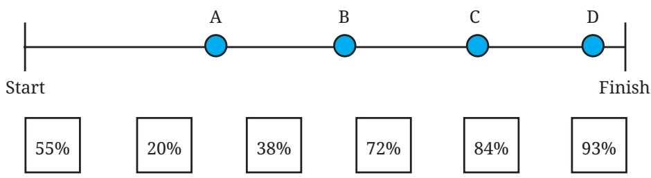

3. In a school, 15 of the 80 students come to school by walking. What percentage of the students come by walking?

4. A group of friends is participating in a long-distance run. The positions of each of them after 15 minutes are shown in the following picture. Match (among the given options) what percentage of the race each of them has approximately completed.

5. Pairs of quantities are shown below. Identify and write appropriate symbols ‘>’, ‘<’, ‘=’ in the blanks. Try to do it without calculations. (i) 50% \_\_\_\_ 5% (ii) $\frac{5}{10} \xlongequal{ 尨 } 50\%$ (iii) $\frac { 3 } { 1 1 }$ 61% (iv) 30% $\frac{1}{3}$

? Well, if percentages are just a particular type of fraction, why do we need them? Why can’t we just continue using fractions? Let us consider an example.

A biscuit-making factory is experimenting with 2 new varieties of biscuits. Sugar makes up $\frac{9}{34}$ of Variety 1 and $\frac{13}{45}$ of Variety 2. Which variety is more sugary? It may not be clear at first glance and we may have to do some calculations. But, when the same information is presented as — Sugar makes up 26.47% of Variety 1 and 28.88% of Variety 2, it is immediately clear which variety is more sugary.

If we want to have the same denominator, why choose 100 in particular? Why not 10, 50, 1000, or 43? Think.

In principle, we could choose any number as the denominator. But with 100, there are some advantages. Since our number system is base 10, numbers like 10, 100, and 1000 fit easily with decimals. For example, $31\% = \frac{31}{100} = 0.31.$

Converting between fractions, decimals, and percentages becomes quick and intuitive.

The number 100 is round, and easy to understand and work with. We could say “per 1000” or “per 100,000” (this usage is present in statistics like “per thousand people” or “per lakh”), but 100 hits the sweet spot — it’s large enough to give detail, yet simple enough to grasp mentally. Per 10 would be too small for many purposes.

$$
\frac{9}{34} = 26.47    percent   ( per   100)
$$

$$
\frac{9}{34} = 2.647    per decem   ( per   10)
$$

$\frac { 9 } { 3 4 }   = 2 6 4 . 7$ per mille (per 1000)