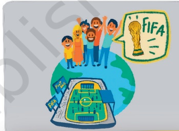
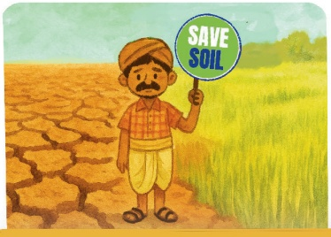

Long before the decimal fraction was introduced, the need for it was felt in computations by tenths, twentieths, and hundredths. The idea of ‘per hundred’ can be found as early as the 4th century BCE in Kautilya’s Arthaśhāstra, “An interest of a pana and a quarter per month per cent is just. Five panas per month per cent is commercial interest. Ten panas per month per cent prevails among forests. Twenty panas per month per cent prevails among sea traders”.

Around the same time, the Romans used taxes of $\frac { 1 } { 2 0 } , \frac { 1 } { 1 0 0 }$ in transactions related to trade and auctions. In the Italian manuscripts of the 15th century, expressions such as ‘xx p cento’, ‘x p cento’, ‘vii p cento’ can be found (equivalent to our 20%, 10%, and 7%).

## Percentages Around Us

Percentages are widely used in a variety of contexts. Here are some interesting findings that involve percentages.

The human body, on average, is about 60% water by weight.

Ice cream is about 30 – 50% air by volume.

45% of the world̛s population watched at least part of the 2022 FIFA World Cup.

Sun: \~99.86%

Over 80% of the teenagers globally fail to meet the recommendation of at least one hour of daily physical actvity.

000 → Everything else: \~0.069%

About 99.86% of the Solar System̛s mass is contained in the Sun.

An estimated 52% of the agricultural land worldwide is degraded.