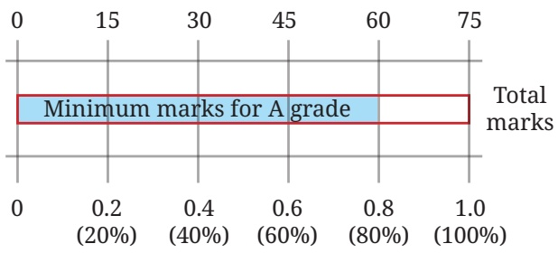
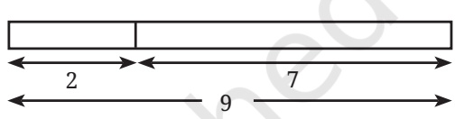

Fraction Multiplication → $\frac { 8 0 } { 1 0 0 } \times 7 5$ $\textstyle { \frac { 4 } { 5 } } \times 7 5 = 6 0 .$

Decimal Multiplication $\rightarrow 0.8 \times 75 = 60.$ Proportional Reasoning → Out of 100, the minimum mark is 80. Out of 75, it is

$$
\frac{75 \times 80}{100} = 60.
$$

？ **Example 4:** To prepare a particular millet kanji (porridge), suppose the ratio of millet to water to be mixed for boiling is 2:7. What percentage does the millet constitute in this mixture? If 500 ml of the mixture is to be made, how much millet should be used?

This situation can be modelled as shown in the bar model on the right side.

The ratio of millet to the volume of the mixture is 2:9. In other words, in one unit of the mixture, millet occupies $\frac { 2 } { 9 }$ units and water occupies $\frac { 7 } { 9 }$ units.

## Estimate first what percentage $\frac{2}{9}$ would be.

The percentage (i.e., in 100 such units) of millet in the mixture is

$$
\frac{2}{9} \times 100 = 22.22\%.
$$

Half of 9 is 4.5. So, 2 is clearly less than 50%. Half of is les<u>s than 25%.</u>

10% of 9 is 0.9. 20% of 9 is 1.8. $\scriptstyle { \mathrm { S o } , { \frac { 2 } { 9 } } }$ could be between 20% <u>– 25%.</u>

The percentage of water in the mixture will be 100 – 22.22 = 77.78%.

A mixture with 22.22% millet means 100 ml mixture will have 22.22 ml millet.

Therefore, 500 ml with 22.22% millet will have $5 \times 22.22 = 111.1$ ml of millet.

<u>A given ratio can be converted to a fraction, and then to a percentage.</u>

The practice of estimating first before calculating can improve number sense and help reduce mistakes. Often, we may not need exact values. The ability to make quick estimates is useful at these times.

**Note to the Teacher:** Incorporate the practice of estimating before calculating or solving as part of the problem-solving process. You may remind and encourage students as needed.