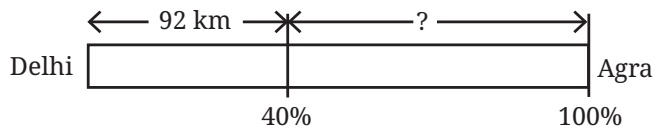

## ？ Example 5: A cyclist cycles from Delhi to Agra and completes 40% of the journey. If he has covered 92 km, how many more kilometres does he have to travel to reach Agra?

Let us first try to model this situation by a bar model.

## Estimate first before solving further.

A few ways of solving this problem are shown below. Does your method match any of the given ones? Do you like any of the other methods?

It is given that 40% of the distance is 92 km. We have to find out how much the rest of the 60% distance is.

## Method 1

40% is 92 km, therefore 20% is 46 km. This makes 60% to be $92+46=138$ km.

## Method 2

If 40% is 92, 60% is ?

$$
4 0 : 9 2 : : 6 0 : ?
$$

$$
\frac { 4 0 } { 9 2 } = \frac { 6 0 } { r }
$$

(r is the remaining

## Method 3

$$
\frac { 4 0 } { 1 0 0 } = \frac { 9 2 } { d }
$$

(d is the total distance)

$$
d = 92 \times \frac{100}{40} = 230.
$$

$$
\frac{ Remaining distance }{230 km - 92 km }
$$

## Method 4

If x is the remaining distance then the total distance from Delhi to Agra is $x + 92.$ . Since, we know that 92 is 40% of this total distance,

$$
\frac{40}{100} \times (x + 92) = 92.
$$

$$
(x + 92) = 92 \times \frac{100}{40}
$$

$$
x = 230 - 92 = 138.
$$

$$
r = 60 \times \frac{92}{40} = 138.
$$

Drawing rough diagrams can help understand the given situation better and make it easier to think further about the problem.

## Percentages Greater than 100

Till now, we saw percentages with a value 100 or less than 100. Can there be percentages with a value more than 100? What could it mean when a percentage is greater than 100? Let us explore.

？ **Example 6:** Kishanlal recently opened a garment shop. He aims to achieve a daily sales of at least ₹5000. The sales on the first 2 days were ₹2000 and ₹3500. What percentage of his target did he achieve?