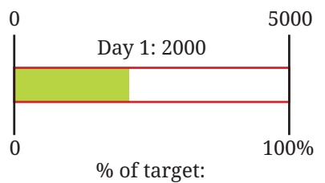
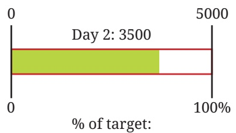
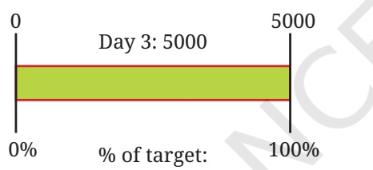
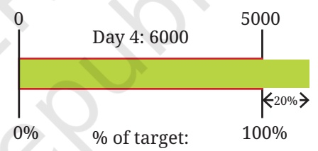
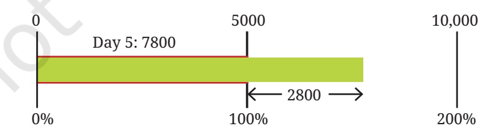
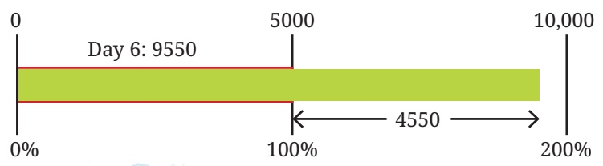

11

The percentage target achieved is visualised below.

$$
\frac{2000}{5000} \times 100 = 40\%
$$

3500 5000 × 100 = 70%

$$
40\% = \frac{40}{100} = \frac{2}{5} = 0.4
$$

$$
70\% = \frac{70}{100} = \frac{7}{10} = 0.7
$$

It is 40% on Day 1 and 70% on Day 2.

Another way of saying it is — he was 60% short of his target on Day 1 and 30% short of his target on Day 2.

? In the next two days, he made ₹5000 and ₹6000 respectively. What percentage of his target are these values?

His target is ₹5000, and he made ₹5000 on Day 3 — this is 100%. On Day 4, he made ₹6000, which is 1000 more than his target.

? What percentage of the target was achieved on Day 4?

$$
\frac{5000}{5000} \times 100 = 100\%
$$

$$
\frac{6000}{5000} \times 100 = 120\%
$$

$$
100\% = \frac{100}{100} = \frac{1}{1} = 1.0
$$

$$
120\% = \frac{120}{100} = \frac{6}{5} = 1.2
$$

1000 is 20% of 5000. Therefore, 6000, (5000 + 1000) is $100\% + 20\%$ = 120% of 5000. It can also be computed as $\frac{6000}{5000} \times 100 = \frac{6}{5} \times 100 = 120\%.$ This means he achieved 120% of his target, i.e., 20% more than his target.

？ On Days 5 and 6 his sales were ₹7800 and ₹9550 respectively. Calculate the percentage of the target achieved on these days.

