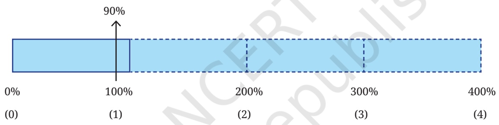
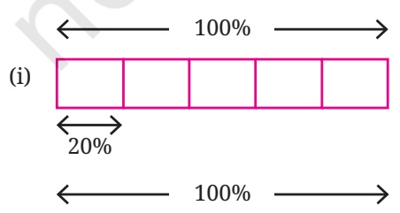
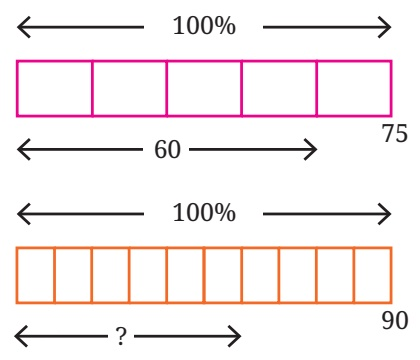

？ On Day 7, he achieved 150% of his target. On Day 8, he achieved 210% of his target. Find the sales made on these days.

Suppose on some day, he made ₹2500. This can be expressed as “He achieved $\frac { 1 } { 2 }$ of his target” or “He achieved 50% of his target” or “He achieved 0.5 of his target”. On some other day, he made ₹10,000. We can say “He achieved twice/double/2 times his target” or “He achieved 200% of his target”.

？ Complete the table below. Mark the approximate locations in the following diagram.

(ii)

| Percent | 90% | 110% | 200% | 250% | 15% | 173% | 358% | 28.9% | 305% |
| --- | --- | --- | --- | --- | --- | --- | --- | --- | --- |
| Fraction |  |  |  |  |  |  |  |  |  |
| Decimal |  |  |  |  |  |  |  |  |  |

## ？ Example 7: A farmer harvested 260 kg of wheat last year. This year, they harvested 650 kg of wheat. What percentage of last year’s harvest is this year’s harvest?

This year’s harvest $\frac{650}{260} \times 100 = 250\%$ of last year’s harvest. 250% indicates that it is 2.5 times the original value.

## Figure it Out

Estimate first before making any computations to solve the following questions. Try different methods including mental computations.

1. Find the missing numbers. The first problem has been worked out.

