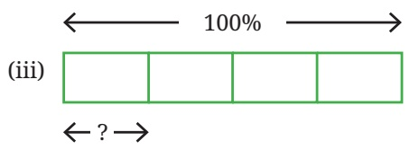
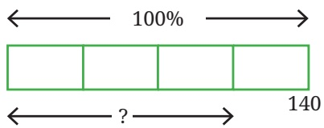
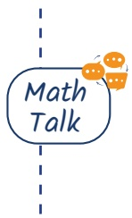

2. Find the value of the following and also draw their bar models. (i) 25% of 160 (ii) 16% of 250 (iii) 62% of 360 (iv) 140% of 40 (v) 1% of 1 hour (vi) 7% of 10 kg

3. Surya made 60 ml of deep orange paint, how much red paint did he use if red paint made up $\frac { 3 } { 4 }$ of the deep orange paint?

4. Pairs of quantities are shown below. Identify and write appropriate symbols ‘>’, ‘<’, ‘=’ in the boxes. Visualising or estimating can help. Compute only if necessary or for verification. (i) 50% of 510 50% of 515 (ii) 37% of 148 73% of 148 (iii) 29% of 43 92% of 110 (iv) 30% of 40 40% of 50 (v) 45% of 200 10% of 490 (vi) 30% of 80 24% of 64

5. Fill in the blanks appropriately:

(i) 30% of k is 70, 60% of k is \_, 90% of k is \_, 120% of k is

(ii) 100% of m is 215, 10% of m is \_, 1% of m is \_, 6% of m is

(iii) 90% of n is 270, 9% of n is , 18% of n is \_\_\_\_\_, 100% of n is

(iv) Make 2 more such questions and challenge your peers.

6. Fill in the blanks:

(i) 3 is \_\_\_\_ % of 300.

(ii) \_\_\_\_\_ is 40% of 4.

(iii) 40 is 80% of

7. Is 10% of a day longer than 1% of a week? Create such questions and challenge your peers.

8. Mariam’s farm has a peculiar bull. One day she gave the bull 2 units of fodder and the bull ate 1 unit. The next day, she gave the bull 3 units of fodder and the bull ate 2 units. The day after, she gave the bull 4 units and the bull ate 3 units. This continued, and on the 99th day she gave the bull 100 units and the bull ate 99 units. Represent these quantities as percentages. This task can be distributed among the class. What do you observe?

