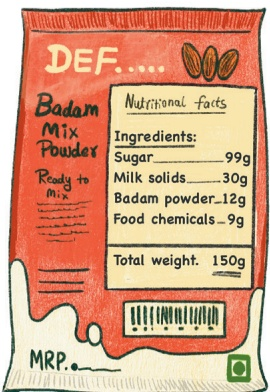
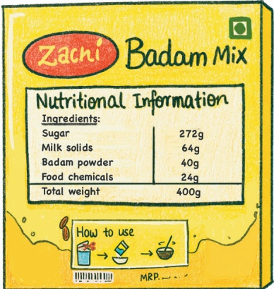
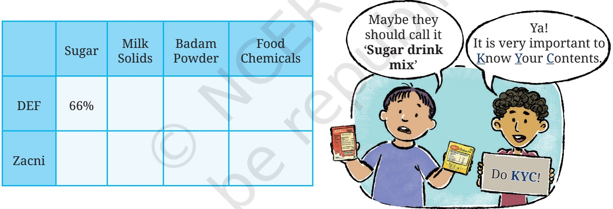

## Know Your Contents (KYC)

? **Example 2:** Madhu and Madhav recently learnt about the importance of reading labels on processed food before purchase. They are at a shop to buy badam drink mix. They are looking at two products and wondering which has a larger share of badam. Can you figure it out? Which product uses a smaller proportion of food chemicals?

It is easier to compare the proportions of the ingredients if we convert them into percentages. For example,

DEF’s sugar content as a percentage of total weight $\frac{99}{150} \times 100 = 66\%.$

? Complete this table by calculating the percentages to answer the questions:

<table><tr><td></td><td></td><td>Mids</td><td>Bada</td><td>Cheddals</td></tr><tr><td></td><td></td><td></td><td></td><td></td></tr><tr><td></td><td></td><td></td><td></td><td></td></tr></table>

## Check if the percentages of each product add up to 100.

## Percentage Increase or Decrease

Percentages are often used to describe the rate of change of quantities. For example,

1. Suppose the price of 1 kg tomatoes 3 years ago was ₹30, and the price now is ₹42. The increase in the price is ₹12.

$$
\begin{aligned} &\text { (Percentage increases=} \frac{a m o u n t   o f i n c r e a s e}{o r i g i n a l   a m o u n t   o r   b a s e} \times 100 \text {) }\\ &\quad = \frac{12}{30} \times 100 = 40\% .\\ \end{aligned}
$$

We say the price of tomatoes increased by 40% over the last 3 years.