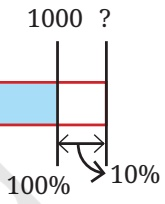

For example, a bank says that the interest rate for fixed deposits is 10% p.a. What do you understand by this statement? What is the ‘p.a.’ next to the percentage?

‘p.a.’ is the short form of per annum, which means for every year. The specified interest rate indicates that if you invest ₹6000 as a deposit for a year with the bank, they will give you ₹600 as interest on this deposit. The 10% is the **rate of interest** and the ₹6000 on which the interest is calculated is the **principal**. The amount after 1 year in your bank account will be

$$
6 0 0 0 \pm ( 0 . 1 0 \times 6 0 0 0 )
$$

(principal) + (10% interest on principal) = 6000 + 600 = 6600.

Principal (initial deposit)

In other words, the amount deposited, Amount after 1 year ₹6000, will become 110% (or increase by 10%),

$$
6000 \times 110\% = 6000 \times \frac{110}{100} = \underline{6000 \times 1.1} = 6600,
$$

This can also be expressed as

Amount after 1 year = Principal (P) + rate of interest (r) of P

？ **Example 7:** If one deposits ₹6000 in the bank, what is the amount after 3 years?

That depends on the choice of FD. There are two possibilities:

1. Option 1: The interest is paid out regularly (for example, every year). The principal amount is returned after the maturity period.

<table><tr><td></td><td></td><td>Interest returned(10% p.a.)</td><td>Amount inthe FD</td></tr><tr><td rowspan=2>Year 1</td><td>Beginning</td><td>× 0.1</td><td>₹60000</td></tr><tr><td>Ending</td><td>₹600returned</td><td>₹6000</td></tr><tr><td rowspan=2>Year 2</td><td>Beginning</td><td>×0.1</td><td>₹60000</td></tr><tr><td>Ending</td><td>₹600returned</td><td>₹6000</td></tr><tr><td rowspan=2>Year 3</td><td>Beginning</td><td>× 0.1</td><td>₹60000</td></tr><tr><td>Ending</td><td>₹600returned</td><td>₹6000</td></tr><tr><td colspan=2>Total amount received</td><td colspan=2>₹1800 + ₹6000 = ₹7800</td></tr></table>